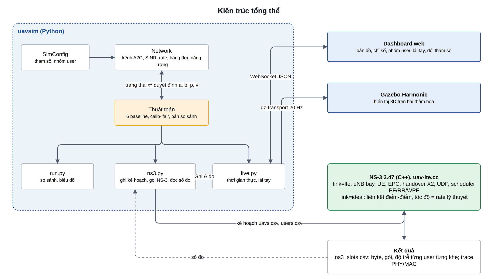

# Cấp phát tài nguyên cho mạng nhiều UAV làm trạm gốc có ưu tiên người dùng

Đồ án môn Lập trình mạng. Nhiều UAV mang trạm gốc LTE bay tới vùng thiên tai để phát sóng cho người dùng mặt đất.
Người dùng chia thành ba nhóm ưu tiên: **normal** (người dân), **important** (điều phối, camera) và **critical** (đội
cứu hộ, y tế). Mỗi giây, hệ thống phải quyết định người dùng nối với UAV nào, mỗi người được bao nhiêu băng thông, và
UAV bay về đâu.

Nhóm xây dựng heuristic **calib-ifair**: ưu tiên nhóm critical mà không bỏ rơi các nhóm khác. Khác với các bài báo chỉ
tính bằng công thức Shannon, mọi kết quả ở đây được **đo lại ở mức gói tin bằng NS-3 LTE** (eNB bay, handover, UDP thật).


## Kết quả chính

Đo bằng NS-3 LTE: 3 UAV, 20 người dùng (3 critical, 5 important, 12 normal), lưu lượng 4 Mbps mỗi người, trung bình
3 seed.

| | kmeans-equal | kmeans-wmaxmin (cũng biết nhóm) | **calib-ifair** |
|---|---|---|---|
| Người dùng critical đạt chất lượng dịch vụ | 69% | 86% | **96%** |
| Tốc độ tối thiểu nhóm critical | 1.64 Mbps | 2.79 Mbps | **3.25 Mbps** |
| Tốc độ tối thiểu nhóm normal | 0.68 Mbps | 0.49 Mbps | **0.95 Mbps** |
| Throughput tổng | **49.9 Mbps** | 44.3 Mbps | 44.1 Mbps |

- calib-ifair ưu tiên được nhóm critical, kể cả so với baseline max-min có trọng số cùng biết nhóm người dùng.
- Đổi lại, throughput tổng ở tải cao thấp hơn khoảng 11% so với baseline không biết nhóm. Đây là đánh đổi có chủ đích.
- Mô hình khớp NS-3 với liên kết lý tưởng dưới 1% (105 lần chạy). Trên LTE thật, tốc độ chỉ bằng 25–40% con số
  Shannon mà các bài báo dùng.

## Thuật toán calib-ifair

Mỗi khe thời gian, heuristic làm ba bước rồi áp quyết định xuống tầng MAC:

1. **Liên kết và SINR có nhiễu:** người dùng nối UAV có kênh mạnh nhất; SINR tính cả nhiễu từ các UAV khác.
2. **Chia băng (ifair):** b<sub>k</sub> ∝ w<sub>k</sub> / ŜE<sub>k</sub>, với trọng số w = 1 / 2 / 4 theo nhóm. Trong
   mỗi UAV, người dùng critical được tốc độ gấp 4 lần người dùng normal.
3. **Di chuyển (calib):** UAV bay về tâm cụm người dùng, rồi thử 17 nước đi và giữ nước làm tăng Σ w·log(tốc độ).
4. **Áp ở tầng MAC:** b<sub>k</sub> làm trọng số cho scheduler Weighted PF viết thêm trong NS-3.

Công thức, mã giả và lưu đồ: [`docs/THUAT_TOAN_DE_XUAT.md`](docs/THUAT_TOAN_DE_XUAT.md).

## Kiến trúc



- **`uavsim` (Python):** mô hình kênh, SINR, hàng đợi, năng lượng bay; các thuật toán; môi trường học tăng cường.
- **NS-3 3.47 LTE (C++):** phát lại kế hoạch của thuật toán và đo throughput, độ trễ, mất gói từng người dùng.
- **Dashboard web và Gazebo:** điều khiển và quan sát thời gian thực, đo NS-3 ngay từ trình duyệt.

## Cài đặt

Yêu cầu: Ubuntu 22.04, Python 3.10, NS-3 3.47 có module `lte`. Gazebo Harmonic chỉ cần khi muốn xem 3D.

```bash
git clone https://github.com/vietdai-bk/uav-bs-resource-allocation.git
cd uav-bs-resource-allocation
python3 -m venv .venv
.venv/bin/pip install -r requirements.txt

# đưa kịch bản NS-3 vào thư mục NS-3 rồi build
ns3/install.sh <thư-mục-ns-3.47>
```

## Chạy nhanh

```bash
# so sánh thuật toán trên mô hình
.venv/bin/python -m uavsim.run

# đo bằng NS-3 LTE, có ba nhóm người dùng
.venv/bin/python -m uavsim.ns3 --algos kmeans-wmaxmin calib-ifair --scheduler wpf \
    --set slots=60 --set demand_mbps=2 --set important_frac=0.25 --set critical_frac=0.15

# dashboard thời gian thực tại http://localhost:8000 (bỏ --gazebo nếu không có Gazebo)
.venv/bin/python -m uavsim.live --gazebo

# kiểm thử
.venv/bin/python -m pytest -q tests
```

Mọi tham số, lệnh tái lập từng thí nghiệm và kết quả chi tiết: [`docs/HUONG_DAN_CHAY.md`](docs/HUONG_DAN_CHAY.md).

## Cấu trúc thư mục

```
uavsim/              mô hình, thuật toán, dashboard, kết nối NS-3 và Gazebo
ns3/scratch/uav_lte/ kịch bản NS-3 LTE và scheduler Weighted PF
experiments/         script vẽ biểu đồ, kết quả các thí nghiệm (results/)
tests/               42 test tự động
docs/                báo cáo, thiết kế, thuật toán, hướng dẫn, sơ đồ draw.io
slides/              slide bảo vệ (LaTeX Beamer)
```

## Tài liệu

| Tài liệu | Nội dung |
|---|---|
| [`docs/BAO_CAO_DU_AN.md`](docs/BAO_CAO_DU_AN.md) | Báo cáo đầy đủ: bài toán, mô hình, triển khai, kết quả, kết luận |
| [`docs/THUAT_TOAN_DE_XUAT.md`](docs/THUAT_TOAN_DE_XUAT.md) | Bài toán tối ưu, mã giả, lưu đồ của calib-ifair |
| [`docs/MO_TA_DU_AN.md`](docs/MO_TA_DU_AN.md) | Mô tả ngắn toàn dự án |
| [`docs/THIET_KE_MO_PHONG.md`](docs/THIET_KE_MO_PHONG.md) | Thiết kế mô phỏng, công thức, thông số |
| [`docs/HUONG_DAN_CHAY.md`](docs/HUONG_DAN_CHAY.md) | Hướng dẫn chạy chi tiết, kết quả từng thí nghiệm |
| [`docs/KICH_BAN_THUYET_TRINH.md`](docs/KICH_BAN_THUYET_TRINH.md) | Kịch bản thuyết trình và câu hỏi thường gặp |
| [`slides/main.pdf`](slides/main.pdf) | Slide bảo vệ |

## Hạn chế

calib-ifair là heuristic nên không đảm bảo nghiệm tối ưu. Thí nghiệm mới dùng một cấu hình (3 UAV, 20 người dùng, đô
thị) với 3 seed; NS-3 phát lại kế hoạch chứ chưa chạy vòng kín với thuật toán. Chi tiết ở mục 7.2 của báo cáo.
