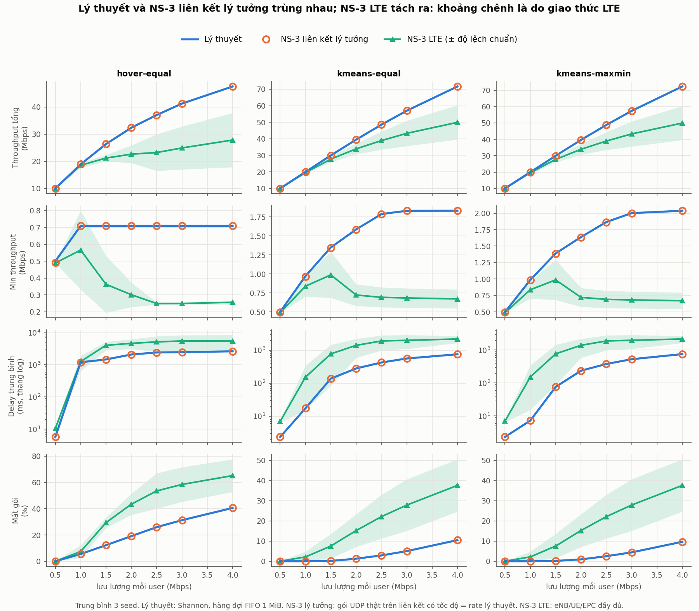

# uavsim: cấp phát tài nguyên cho mạng Multi-UAV Base Station, mô hình Python + đo bằng NS-3 LTE

Hệ thống có hai tầng:

1. **Mô hình Python (`uavsim`)**: nơi ra quyết định. Bài toán là nhiều UAV làm trạm gốc trên không phục vụ user
   mặt đất, theo cách các paper IEEE về UAV resource allocation thường làm: kênh Air-to-Ground Al-Hourani, rate
   Shannon (hoặc Shannon cắt ngọn kiểu LTE) có nhiễu đồng kênh, năng lượng bay UAV cánh quay (Zeng 2019), thời gian
   chia khe. Thuật toán (heuristic, tối ưu, DRL) được cắm vào qua một giao diện chung.
2. **NS-3 LTE (`ns3/scratch/uav_lte`)**: nơi đo, bằng mô phỏng mức gói tin. Kế hoạch của thuật toán (quỹ đạo UAV,
   liên kết user–UAV, rate cấp cho mỗi user) được phát lại trong NS-3. Mỗi UAV là một eNB, mỗi user là một UE, có
   EPC, handover X2 và luồng UDP downlink. FlowMonitor và trace đo throughput, delay, mất gói. Kênh Al-Hourani được
   cài thành một `PropagationLossModel` của NS-3, dùng cùng công thức với Python.

**Phân biệt hai loại số liệu:**
- số liệu của **mô hình** là kết quả *tính* theo công thức giải tích (Shannon), giống cách các paper thường làm;
- số liệu **NS-3** là kết quả *đo* trên mô phỏng giao thức LTE.

Cả hai đều là mô phỏng, không phải thử nghiệm phần cứng.

```
uavsim (Python)                         NS-3 3.47 LTE (C++)
thuật toán chạy theo từng khe ──uavs.csv, users.csv──► eNB bay theo quỹ đạo, UE, EPC, handover X2
                                                       UDP downlink đúng rate kế hoạch
                              ◄──────ns3_slots.csv──── throughput, delay, mất gói từng khe
so sánh mô hình vs NS-3, vẽ biểu đồ
```

Tài liệu chi tiết về mô hình, công thức, thông số và thuật toán:
[`docs/THIET_KE_MO_PHONG.md`](docs/THIET_KE_MO_PHONG.md). Đặc tả yêu cầu:
`dac_ta_trien_khai_claude_multi_uav.docx`.

> Phiên bản trước của dự án (dashboard web + NS-3 Wi-Fi/UDP + Gazebo, phân bổ ngân sách lưu lượng Equal/Weighted)
> đã được thay thế. Mã cũ không còn trong thư mục này.

## Mô hình tóm tắt

| Thành phần | Mô hình |
|---|---|
| Kịch bản | M UAV ở độ cao cố định H, downlink tới K user; mỗi user gắn vào một UAV |
| Kênh | Al-Hourani 2014 (xác suất LoS theo góc nâng, 4 môi trường) hoặc LoS β₀/d²; fading Rician tùy chọn |
| Đa truy nhập | OFDMA trong mỗi UAV; các UAV dùng lại cùng băng (reuse 1), nên có nhiễu đồng kênh |
| Rate | `shannon`: r_k = b_k·B·log₂(1 + SINR_k); `lte`: 3GPP TR 36.942, 0.6·log₂(1+SINR) cắt ở 4.4 bit/s/Hz, bằng 0 khi SINR < −10 dB |
| Năng lượng | Công suất bay UAV cánh quay, Zeng–Xu–Zhang 2019 (168.5 W khi hover) |
| Biến quyết định mỗi khe | liên kết user–UAV, tỷ lệ băng thông, công suất, vận tốc UAV |
| Lưu lượng, hàng đợi (tùy chọn `demand_mbps`) | Mỗi user nhận CBR `demand_mbps`; hàng đợi `Q ← min(max(Q + A − r·Δt, 0), bộ đệm)` (kiểu Lyapunov); delay FIFO chính xác của từng bit + thời gian truyền 1 gói; mất gói = phần tràn bộ đệm 1 MiB |
| Chỉ số | sum rate, min rate, Jain, coverage (r ≥ r_min), năng lượng, hiệu suất năng lượng (bit/J); khi có `demand_mbps`: throughput, min throughput, delay, mất gói |

## Môi trường đã kiểm chứng

Ubuntu 22.04, Python 3.10.12, numpy 2.2.6, matplotlib 3.9.4, gymnasium 1.0.0, pytest 8.4.2,
NS-3 3.47 (build sẵn tại `~/simulation/ns-3.47`, profile default, có module `lte`).
`ffmpeg` là tùy chọn, chỉ cần khi xuất animation dạng `.mp4`.

## Cài đặt

```bash
cd ~/LapTrinhMang
python3 -m venv .venv            # venv hiện có được tạo với --system-site-packages; venv sạch cũng chạy được
.venv/bin/pip install -r requirements.txt

# kịch bản NS-3: symlink ns3/scratch/uav_lte vào <NS3_DIR>/scratch rồi build
ns3/install.sh ~/simulation/ns-3.47
```

NS-3 nằm chỗ khác thì đặt biến môi trường `NS3_DIR` khi chạy `uavsim.ns3`. Script cài đặt tự gỡ các symlink hỏng
trong `scratch/`, vì chúng làm cmake báo lỗi khi configure.

## Chạy

### So sánh thuật toán

```bash
.venv/bin/python -m uavsim.run                                   # 6 baseline, 3 seed, tham số mặc định
.venv/bin/python -m uavsim.run --algos hover-equal kmeans-equal kmeans-maxmin --seeds 5 \
    --set num_uavs=5 --set num_users=40 --set environment=dense_urban --set rician_k_db=10
.venv/bin/python -m uavsim.run --config my_scenario.json --out experiments/results/thu1
```

- `--set KEY=VAL` ghi đè bất kỳ tham số nào trong `uavsim/config.py: SimConfig`, lặp được nhiều lần.
- `--config` đọc file JSON; khóa phải trùng tên tham số, khóa lạ bị từ chối.

Kết quả nằm trong `experiments/results/<thời gian>/`:

| File | Nội dung |
|---|---|
| `config.json` | Cấu hình đã chạy, kèm danh sách thuật toán và số seed |
| `timeseries.csv` | Chỉ số từng khe |
| `summary.csv` | Trung bình mỗi episode, kèm `energy_eff` |
| `compare.png` | Sum rate, min rate theo thời gian, quỹ đạo UAV |

### Đo bằng NS-3 LTE

```bash
.venv/bin/python -m uavsim.ns3 --algos hover-equal kmeans-equal kmeans-maxmin --set slots=60
.venv/bin/python -m uavsim.ns3 --algos kmeans-equal --scheduler rr --load 0.8 --seeds 3 --set num_uavs=2

# ma trận thí nghiệm đã chạy (90 run, ~36 phút với --parallel 10 trên máy 12 nhân)
.venv/bin/python -m uavsim.ns3 --algos hover-equal kmeans-equal kmeans-maxmin \
    --load 0.5 0.6 0.7 0.8 0.9 1.0 --seeds 5 --set slots=60 --parallel 10 --out experiments/results/ns3-matrix
```

| Tham số | Ý nghĩa |
|---|---|
| `--scheduler pf\|rr\|wpf` | MAC scheduler LTE: Proportional Fair, Round Robin, hoặc `wpf` = PF có trọng số b_k của thuật toán (áp cấp phát băng thông ở tầng MAC, mục 7) |
| `--load` | Một hoặc nhiều hệ số nhân rate kế hoạch khi gửi vào NS-3; `0.5` là gửi một nửa rate kế hoạch |
| `--link lte\|ideal` | `lte` (mặc định): mạng LTE đầy đủ. `ideal`: bỏ LTE, mỗi user một liên kết điểm-điểm có tốc độ từng khe bằng đúng rate lý thuyết, hàng đợi 1 MiB; dùng để kiểm chứng mô hình hàng đợi ở mức gói tin (mục 8). Chỉ có ý nghĩa khi có `demand_mbps`; nhanh hơn LTE khoảng 20 lần |
| `--parallel` | Số run NS-3 chạy song song (mặc định bằng nửa số CPU) |
| `--traces` | Ghi trace PHY/MAC của LTE (`DlRsrpSinrStats`, `DlRxPhyStats`, `DlMacStats`) và tính SINR, MCS, tỷ lệ lỗi khối, HARQ, hiệu suất phổ mỗi cell. Trace khoảng 25 MB/run cho 30 khe; đọc được cả file `.gz` |
| `--set interference=false` | Trong NS-3: mỗi eNB một kênh 10 MHz riêng (không chồng lấn), nên không có nhiễu liên cell |
| `--set`, `--config`, `--seeds`, `--out` | Như `uavsim.run` |

- Khi không có `demand_mbps` và `--link lte`, lệnh này tự đặt `rate_model=lte`, vì gửi rate Shannon thuần vào LTE chắc
  chắn gây quá tải.
- `bandwidth` phải là băng LTE: 1.4, 3, 5, 10, 15 hoặc 20 MHz.
- Thời gian chạy khoảng 1.8 s cho mỗi khe với 3 eNB và 20 UE, nên 200 khe mất khoảng 6 phút mỗi run.

Kết quả nằm trong `experiments/results/ns3-<thời gian>/`:

| File | Nội dung |
|---|---|
| `config.json` | Cấu hình, scheduler, load |
| `summary_ns3.csv` | Mỗi thuật toán × load × seed: sum/min rate của mô hình và NS-3, tỷ lệ chuyển được, Jain, coverage, delay, mất gói, tỷ lệ khớp cell |
| `aggregate_ns3.csv` | Trung bình ± độ lệch chuẩn qua seed cho mỗi thuật toán × load |
| `ns3_matrix.png` | 6 biểu đồ theo load (chỉ khi có ≥ 2 mức load) |
| `ns3_compare.png` | Sum rate kế hoạch vs NS-3, delay và mất gói theo thời gian (seed đầu, load cao nhất) |
| `<algo>_load<l>_seed<s>/plan/` | `uavs.csv`, `users.csv`: kế hoạch gửi cho NS-3 |
| `<algo>_load<l>_seed<s>/ns3_slots.csv` | Số đo NS-3 thô, mỗi khe × mỗi UE |
| `<algo>_load<l>_seed<s>/compare_slots.csv` | Mô hình và NS-3 đặt cạnh nhau theo từng khe |
| `<algo>_load<l>_seed<s>/flowmon.xml` | FlowMonitor |
| `<algo>_load<l>_seed<s>/ns3.log` | Dòng lệnh NS-3 đầy đủ, số handover, thời gian chạy |

Gọi binary trực tiếp (xem `--help` để biết mọi tham số):

```bash
LD_LIBRARY_PATH=~/simulation/ns-3.47/build/lib \
~/simulation/ns-3.47/build/scratch/uav_lte/ns3.47-uav-lte-default --plan=<dir>/plan --out=<dir> --slots=10
```

### Delay và mất gói: chạy lý thuyết như paper rồi đo lại bằng NS-3

```bash
# 1) lý thuyết (giống paper): mỗi user 2 Mbps CBR, rate Shannon, hàng đợi -> throughput, delay, mất gói
.venv/bin/python -m uavsim.run --algos hover-equal kmeans-equal kmeans-maxmin --set demand_mbps=2

# 2) phát lại trong NS-3 với cùng lưu lượng; quét lưu lượng mỗi user = demand × load (0.5…4 Mbps)
.venv/bin/python -m uavsim.ns3 --algos hover-equal kmeans-equal kmeans-maxmin --set demand_mbps=1 \
    --load 0.5 1 1.5 2 2.5 3 4 --seeds 3 --set slots=60 --parallel 10 --out experiments/results/ns3-demand

# 3) so các biến thể lý thuyết với NS-3 (không chạy lại NS-3)
.venv/bin/python -m uavsim.validate --demand-run experiments/results/ns3-demand --fit experiments/results/validation/fit.json
```

Khi có `demand_mbps`, NS-3 gửi đúng lưu lượng đó cho mỗi user, và lý thuyết giữ mặc định Shannon như paper. Ba tùy
chọn bật thêm cơ chế của LTE vào lý thuyết, mặc định đều tắt:

| Tùy chọn | Cơ chế |
|---|---|
| `--set rate_model=lte --set lte_alpha=0.401 --set lte_se_max=3.514` | Ánh xạ SINR → rate của LTE (mục 4) |
| `--set work_conserving=true` | Trong mỗi UAV, phần băng user không cần được chia lại cho user còn chờ, giống scheduler LTE |
| `--set load_coupled=true` | Nhiễu từ một UAV tỷ lệ với phần băng nó thực sự dùng, giống eNB chỉ phát trên RB được cấp |

So ba tầng (lý thuyết / NS-3 liên kết lý tưởng / NS-3 LTE) trên cùng cấu hình:

```bash
.venv/bin/python -m uavsim.ns3 --link ideal --algos hover-equal kmeans-equal kmeans-maxmin --set demand_mbps=1 \
    --load 0.5 1 1.5 2 2.5 3 4 --seeds 3 --set slots=60 --parallel 10 --out experiments/results/ns3-demand-ideal
.venv/bin/python -m uavsim.ns3 --link lte --algos hover-equal kmeans-equal kmeans-maxmin --set demand_mbps=1 \
    --load 0.5 1 1.5 2 2.5 3 4 --seeds 3 --set slots=60 --parallel 10 --out experiments/results/ns3-demand-lte
.venv/bin/python experiments/plot_three_tier.py experiments/results/ns3-demand-ideal \
    experiments/results/ns3-demand-lte experiments/results/three_tier_pf.png   # kèm three_tier_pf.csv: sai số từng tầng
```

Khi so với NS-3, mất gói của lý thuyết được tính như NS-3 (1 − nhận/gửi): bit còn trong hàng đợi lúc kết thúc cũng
tính là mất.

### Trạm điều khiển thời gian thực: dashboard web + Gazebo

```bash
.venv/bin/python -m uavsim.live                     # mở http://localhost:8000
.venv/bin/python -m uavsim.live --gazebo            # thêm 3D: cùng kịch bản, nền là bãi của ~/simulation/multi_uav
.venv/bin/python -m uavsim.live --algo calib-ifair --set num_uavs=4 --set demand_mbps=2
```

Mô hình chạy đúng thời gian thực với khe 0.25 s (đổi bằng `--dt`; có thể tăng tốc 0.5×, 1×, 2×, 4× trên web). Mỗi
khe, thuật toán ra quyết định như bình thường; UAV nào đang lái tay thì vận tốc lấy từ dashboard (vẫn bị cắt về
`v_max` và giữ trong vùng). Trang web vẽ lại 60 lần mỗi giây và nội suy vị trí giữa hai khe; Gazebo nhận vị trí nội
suy 20 lần mỗi giây, nên chuyển động liền mạch.

| Khu vực | Chức năng |
|---|---|
| Thanh trạng thái | Kết nối, đang chạy hay tạm dừng, Gazebo, đang ghi, thời gian mô phỏng |
| Dải chỉ số | Tổng rate theo Shannon (như paper) và theo LTE dự đoán (ánh xạ đo từ NS-3), min rate, coverage, Jain, throughput, độ trễ, mất gói, công suất bay |
| Đội UAV | Vị trí, tốc độ, số user của từng UAV; trạng thái tự động, lái tay, bay tới. Nhấp để chọn |
| Lái tay | W A S D, phím mũi tên hoặc nút điều hướng; thanh tốc độ; nút trả về tự động. Nhấp lên bản đồ để UAV đang chọn bay tới điểm đó rồi dừng |
| Bản đồ | UAV, user (màu theo UAV hoặc theo SINR, to theo rate, hình theo nhóm: tròn normal, vuông important, thoi critical, dấu × khi dưới `r_min`), liên kết, đường bay tới đích; tùy chọn nền bản đồ SINR; di chuột để xem SINR và rate của từng user |
| Tham số kịch bản | Số UAV (1–8), số user (1–60), độ cao, công suất, lưu lượng, vận tốc tối đa, user đi bộ, seed, môi trường, phân bố user, bật tắt nhiễu, tỷ lệ user important và critical. Bấm "Áp dụng" để dựng lại kịch bản, Gazebo cập nhật ngay không cần khởi động lại |
| Ba tầng · khe hiện tại | Shannon và LTE dự đoán đặt cạnh nhau |
| Nhóm user · khe hiện tại | Số user, min tốc độ LTE dự đoán và tỷ lệ đạt QoS của từng nhóm normal, important, critical |
| Đo bằng NS-3 | Chọn thời lượng ghi, liên kết (lý tưởng hoặc LTE), scheduler (WPF, PF, RR) rồi bấm "Ghi & đo": server ghi đoạn đó từ khe 0, chạy NS-3 và trả bảng mô hình so với NS-3 về web |
| User · khe hiện tại | Bảng user có cột nhóm, critical lên trước, trong mỗi nhóm user yếu nhất lên đầu; tô đỏ user dưới `r_min` |

Phiên đo được lưu ở `experiments/results/live-<thời gian>/` (kế hoạch, cấu hình, số mô hình, số đo NS-3). Có thể phát
lại bằng dòng lệnh: `python -m uavsim.ns3 --replay <thư mục> --link ideal|lte`.

Lưu ý:
- số trên dashboard là số tính; số đo thật lấy từ "Ghi & đo";
- Gazebo chỉ để xem: không có PX4, không có động lực học bay;
- server chỉ nghe ở `127.0.0.1`; mất kết nối với mọi trình duyệt thì UAV lái tay tự dừng; lệnh hoặc tham số sai chỉ bị
  từ chối, không làm dừng server;
- `--gazebo` vẽ đúng kịch bản của mô hình trên nền bãi thảm họa của `~/simulation/multi_uav` (đổi bằng biến
  `MULTI_UAV_DIR`), tỷ lệ 1 m Gazebo = 10 m mô hình. World dựng sẵn 8 UAV và bể hình người (60 user × 9 màu áo, kèm vòng vàng/đỏ cho nhóm important/critical); model chưa
  dùng nằm dưới mặt đất, nên đổi số UAV, số user không cần khởi động lại Gazebo. 54 người có sẵn của bãi được bỏ trong một bản sao của
  `disaster_site` (dự án gốc không bị sửa). Tắt server thì Gazebo đóng theo;
- Gazebo cần `gz sim` 8 (Harmonic), Python bindings `gz.transport13`, `gz.msgs10`. UAV và người được vẽ bằng khối cơ bản, không cần tải mesh.

### Animation

```bash
.venv/bin/python -m uavsim.animate --algos hover-equal kmeans-equal random-equal \
    --set user_speed=3 --out experiments/results/anim.gif        # hoặc .mp4
```

Cách đọc: ▲ là UAV (kèm vệt quỹ đạo), ● là user tô màu theo UAV phục vụ (chấm càng to thì rate càng cao),
× là user dưới `r_min`.

### Dùng trong code hoặc notebook

```python
from uavsim.config import SimConfig
from uavsim.algorithms import REGISTRY
from uavsim.run import run_episode, summarize

cfg = SimConfig(num_uavs=4, channel="los", seed=7)
rows, traj = run_episode(cfg, REGISTRY["kmeans-maxmin"]())
print(summarize(rows, cfg))
```

## Cắm thuật toán mới

```python
class MyAlgo:
    name = "my-algo"
    def reset(self, net): ...              # đầu episode
    def act(self, net) -> Action: ...      # đọc net.uav_xy, net.user_xy, net.gain [M,K], net.cfg
```

Đăng ký vào `REGISTRY` trong `uavsim/algorithms.py`, sau đó gọi `--algos my-algo`. `Network.check` từ chối mọi
Action vi phạm ràng buộc (Σ băng thông ≤ 1 và Σ công suất ≤ p_max cho mỗi UAV), nên lỗi thuật toán lộ ra ngay.

Baseline có sẵn: `{hover|kmeans|random}-{equal|maxmin}`. Liên kết user–UAV luôn theo gain lớn nhất, công suất tỷ
lệ với băng thông.

**DRL:** `uavsim.env.UavBsEnv` là môi trường Gymnasium. Agent điều khiển vận tốc UAV, còn cấp phát tài nguyên giao
cho allocator heuristic. Reward thay được qua `reward_fn`. Chưa có agent nào được huấn luyện; cần cài thêm
`torch` và `stable-baselines3`.

## Kiểm thử

```bash
.venv/bin/python -m pytest -q tests            # 42 test
```

Các test kiểm tra:
- công thức kênh và năng lượng so với giá trị đã biết;
- rate Shannon và rate LTE cắt ngọn;
- tác động của nhiễu;
- từ chối action sai, giới hạn vận tốc và vùng bay;
- mọi baseline hợp lệ và tái lập được, maxmin cho rate bằng nhau, kmeans tốt hơn hover;
- môi trường Gymnasium qua `check_env`;
- **NS-3:** ở tải 30%, throughput đo được bằng 0.3 × kế hoạch (sai số 10%), mất gói < 2%, cell khớp kế hoạch.
  Test này tự bỏ qua nếu chưa build NS-3.
- **NS-3 trace:** chỉ số trace hợp lệ; mỗi eNB một tần số riêng thì SINR cao hơn dùng chung tần số.
- **Kiểm chứng:** hàm khớp α/trần khôi phục đúng đường cong đã biết; `lte_alpha`, `lte_se_max` cấu hình được.
- **Scheduler `wpf`:** 2 UE trọng số 0.8 / 0.2 chia tài nguyên khoảng 4 : 1, PF gốc chia 1 : 1, tổng như nhau.
- **Hàng đợi:** thiếu tải thì không tồn đọng, quá tải thì đầy bộ đệm và mất đúng phần dư; demand thấp thì không mất
  gói, cao thì mất; kế hoạch gửi NS-3 dùng đúng demand; water-filling max-min; chia linh hoạt không bao giờ tệ hơn
  chia tĩnh; nhiễu theo tải giảm nhiễu khi tải nhẹ.
- **Delay FIFO:** khớp lời giải tay của một trường hợp hàng đợi dâng rồi rút.
- **NS-3 liên kết lý tưởng:** throughput, min, mất gói, delay khớp mô hình hàng đợi (sai số 1–3%).
- **Điều khiển thời gian thực:** UAV lái tay đi đúng vận tốc lệnh (cắt về `v_max`), UAV khác theo thuật toán; phiên
  ghi ra kế hoạch NS-3 hợp lệ; world Gazebo là XML hợp lệ.

## Kết quả

### 1. Mô hình (tính theo công thức, Shannon thuần)

Cấu hình mặc định: 3 UAV, 20 user phân cụm, vùng 1×1 km, H = 100 m, B = 10 MHz, p_max = 1 W, urban, 200 khe;
3 seed. Đây là năng lực **lý thuyết**, không có gói tin, delay hay mất gói.

| Thuật toán | Sum rate (Mbps) | Min rate (Mbps) | Coverage | Năng lượng bay (J/khe) |
|---|---|---|---|---|
| hover-equal | 87 ± 38 | 0.71 | 77% | 505.5 |
| kmeans-equal | 145 ± 22 | 1.85 | 99.4% | 507.8 |
| kmeans-maxmin | 143 ± 22 | 1.90 | 99.6% | 507.8 |
| random-equal | 97 ± 33 | 1.01 | 89% | 534.9 |

Mô hình cho thấy:
- đưa UAV về tâm cụm user là yếu tố chi phối;
- `maxmin` đổi một ít sum rate lấy min rate;
- khi thêm một UAV hoạt động mà dùng chung băng tần, nhiễu đồng kênh có thể làm *giảm* sum rate.

Chi tiết ở mục 14 của tài liệu thiết kế.

### 2. NS-3 LTE (đo bằng mô phỏng mức gói tin)

**Cấu hình ma trận** (`experiments/results/ns3-matrix/`):
- 3 thuật toán × 6 mức load (0.5–1.0) × 5 seed = 90 run;
- mỗi run 60 khe × 1 s, scheduler PF;
- tham số còn lại như mục 1, kế hoạch tính với `rate_model=lte`.

Cả 90 run hoàn tất. Mọi handover đều thành công (tối đa 18 lần mỗi run), `cell_match` = 100%.

Trung bình ± độ lệch chuẩn qua 5 seed (`aggregate_ns3.csv`):

| Thuật toán | Load | Kế hoạch × load (Mbps) | NS-3 (Mbps) | Chuyển được | Delay | Mất gói | Min (Mbps) | Jain |
|---|---|---|---|---|---|---|---|---|
| hover-equal | 0.5 | 22.6 | 22.6 ± 9.0 | 100% | 11 ms | 0.03% | 0.23 | 0.52 |
| | 0.6 | 27.2 | 27.0 ± 11 | 99.6% | 130 ms | 0.5% | 0.25 | 0.51 |
| | 0.7 | 31.7 | 30.0 ± 12 | 94% | 1.5 s | 5.8% | 0.26 | 0.50 |
| | 1.0 | 45.3 | 31.6 ± 14 | 69% | 4.5 s | 31% | 0.26 | 0.49 |
| kmeans-equal | 0.5 | 37.1 | 37.1 ± 8.1 | 100% | 9 ms | 0.02% | 0.48 | 0.71 |
| | 0.6 | 44.6 | 44.4 ± 9.8 | 99.6% | 80 ms | 0.4% | 0.55 | 0.70 |
| | 0.7 | 52.0 | 50.0 ± 11 | 96% | 0.8 s | 4.1% | 0.57 | 0.69 |
| | 1.0 | 74.3 | 52.8 ± 13 | 71% | 2.6 s | 29% | 0.57 | 0.68 |
| kmeans-maxmin | 0.5 | 36.5 | 36.5 ± 7.9 | 99.9% | 20 ms | 0.12% | 0.51 | 0.72 |
| | 0.6 | 43.8 | 43.2 ± 9.3 | 98.6% | 233 ms | 1.4% | 0.55 | 0.71 |
| | 0.7 | 51.1 | 48.5 ± 11 | 95% | 0.8 s | 5.3% | 0.57 | 0.69 |
| | 1.0 | 73.0 | 52.7 ± 13 | 72% | 2.5 s | 28% | 0.57 | 0.68 |

Các mức 0.8 và 0.9 có trong `aggregate_ns3.csv`. Biểu đồ đầy đủ: `ns3_matrix.png`.

Độ lệch chuẩn của throughput tuyệt đối lớn vì mỗi seed là một bản đồ user khác. Vì vậy các so sánh giữa thuật toán
dưới đây là **so sánh cặp trên cùng seed**.

**Quan sát** (chỉ đúng với mô hình và cấu hình này):

1. **Mô hình đánh giá cao hơn LTE khoảng 30%.** Throughput NS-3 bão hòa ở khoảng 32 Mbps (hover) và 53 Mbps
   (kmeans), tức 65–75% so với kế hoạch tính bằng Shannon cắt ngọn 3GPP (trung bình 69–72%). Mục 4 kiểm chứng
   rằng toàn bộ khoảng chênh này nằm ở cách LTE đổi SINR ra throughput (độ dốc và trần thấp hơn công thức). So với
   Shannon thuần, khoảng cách còn lớn hơn nhiều.
2. **Điểm vận hành an toàn là gửi 50–60% rate kế hoạch.** Ở 0.5, mạng chuyển được ≥ 99.9% lượng gửi, delay 9–20 ms.
   Ở 0.6 vẫn chuyển được ≥ 98.6% nhưng delay đã lên 80–233 ms. Từ 0.7 trở đi, hàng đợi RLC tích tụ, delay lên cỡ
   giây và mất gói tăng nhanh. Như vậy, kế hoạch tính theo công thức cần hệ số an toàn khoảng 0.5–0.6.
3. **NS-3 xác nhận lợi ích của việc di chuyển UAV (kmeans so với hover):**
   - min throughput gấp khoảng 2.2 lần và Jain cao hơn khoảng 1.5 lần, thắng ở cả 5/5 seed;
   - throughput tổng trung bình gấp khoảng 2 lần, nhưng chỉ thắng 4/5 seed. Ở một seed, hover hơn khoảng 10%, phù
     hợp với nhận xét của mô hình về nhiễu đồng kênh.
4. **Cấp phát maxmin ở tầng ứng dụng gần như mất tác dụng trong NS-3.**
   - Ở tải 0.5, maxmin vẫn tăng min throughput khoảng 6% (4/5 seed), nhưng delay gấp khoảng 2.3 lần và mất gói gấp
     khoảng 5.5 lần so với equal (5/5 seed). Lý do: maxmin dồn lưu lượng cho user sóng yếu, mà đó lại là những user
     có năng lực LTE thấp hơn mô hình nhiều nhất, nên hàng đợi của họ đầy trước.
   - Ở tải 1.0, hai thuật toán trùng nhau (tỷ lệ 1.00), vì scheduler PF của LTE chia lại resource block.
   - Kết luận: muốn cấp phát có tác dụng thì phải áp ở tầng MAC (scheduler), không chỉ ở tầng ứng dụng.

### 3. Vì sao LTE chỉ đạt chừng đó: thí nghiệm tách nhiễu (NS-3 + trace)

Mục này trả lời câu hỏi *throughput tuyệt đối thấp vì đâu*. Câu hỏi *vì sao mô hình khác NS-3* được kiểm chứng ở
mục 4.

**Cấu hình:** kmeans-equal, load 1.0 (bão hòa), 30 khe, 3 seed, có bật trace. Kết quả nằm trong
`experiments/results/ns3-interference/`.

| | A. 3 UAV chung tần số | B. 3 UAV, mỗi UAV một tần số | C. 1 UAV |
|---|---|---|---|
| Tổng phổ dùng | 10 MHz | 30 MHz | 10 MHz |
| Mô hình LTE (Mbps) | 76.3 | 103.9 | 43.4 |
| NS-3 (Mbps) | 57.1 ± 11 | 80.8 ± 16 | 33.7 ± 0.3 |
| NS-3 / mô hình | 0.75 | 0.78 | 0.78 |
| SINR trung vị (p10) | 19.7 dB (5.7) | 42.0 dB (28.3) | 38.7 dB (23.0) |
| MCS trung bình (tối đa 28) | 21.7 | 28.0 | 27.8 |
| Lỗi khối lần truyền đầu | 0.06% | 0.02% | 0.05% |
| Hiệu suất phổ mỗi cell | 2.19 bit/s/Hz | 3.16 (3.5 ở seed có đủ 3 cell bận) | 3.46 bit/s/Hz |
| Min throughput | 0.65 Mbps | 2.91 Mbps | 1.57 Mbps |

A và B có cùng user, cùng quỹ đạo, chỉ khác tần số. C có bản đồ user khác (1 cụm), vì layout `clustered` sinh số cụm
theo số UAV.

Kết luận:
1. **Trần của LTE 10 MHz SISO là khoảng 3.5 bit/s/Hz mỗi cell** (khoảng 35 Mbps). Khi không có nhiễu, SINR rất cao
   và mọi khối truyền đều ở MCS 28 mà vẫn chỉ đạt chừng đó. Bảng TBS đã bao gồm overhead điều khiển và tín hiệu tham
   chiếu, và cấu hình không có MIMO.
2. **HARQ và lỗi truyền không đóng góp:** tỷ lệ lỗi khối dưới 0.1% ở cả ba cấu hình.
3. **Nhiễu đồng kênh làm giảm năng lực tuyệt đối.** So A với B: SINR trung vị giảm khoảng 22 dB, MCS từ 28 xuống
   khoảng 22, hiệu suất phổ mỗi cell giảm khoảng 37%, throughput tổng giảm khoảng 30% (57 so với 81 Mbps), min
   throughput giảm khoảng 4.5 lần. Mô hình cũng tính nhiễu này, nên nhiễu làm giảm *cả hai bên*; nó không phải nguồn
   chênh lệch giữa mô hình và NS-3 (xem mục 4).
4. **Tuy vậy, dùng chung tần số vẫn hiệu quả hơn tính trên mỗi MHz phổ:** A đạt 5.7 bit/s/Hz trên tổng phổ, còn B
   chỉ 2.7, vì B dùng gấp 3 lần phổ để đổi lấy +42% throughput.
5. Overhead header (PDCP/RLC/MAC/IP/UDP) giữa goodput PHY và payload UDP khoảng 3%.

### 4. Kiểm chứng nguyên nhân chênh lệch giữa mô hình và NS-3

```bash
.venv/bin/python -m uavsim.validate --runs experiments/results/ns3-interference/A_3uav_chung_tan_so \
    experiments/results/ns3-interference/B_3uav_tan_so_rieng experiments/results/ns3-interference/C_1uav
```

Kết quả nằm trong `experiments/results/validation/`: `link_curve.csv`, `calibration.csv`, `fit.json`,
`validation.png`. Ba phép kiểm chứng, mỗi phép cô lập một yếu tố:

**Kiểm chứng 1: đường cong một liên kết.** 1 UAV, 1 user cách ngang 100 m, không nhiễu, gửi bão hòa. Quét công suất
phát từ −40 đến 30 dBm để SINR chạy từ −24 đến 46 dB.

| SINR NS-3 (dB) | SNR mô hình (dB) | MCS NS-3 | Lỗi khối | Hiệu suất phổ NS-3 | 3GPP 36.942 | Tỷ lệ |
|---|---|---|---|---|---|---|
| −14.1 trở xuống | giống hệt | — | — | 0 (UE mất kết nối) | 0 | — |
| −4.1 | −4.1 | 0 | 0 | 0.12 | 0.28 | 0.43 |
| 0.9 | 0.9 | 6 | 0 | 0.50 | 0.69 | 0.72 |
| 5.9 | 5.9 | 10 | 0 | 0.75 | 1.37 | 0.55 |
| 10.9 | 10.9 | 16 | 0 | 1.47 | 2.23 | 0.66 |
| 15.9 | 15.9 | 22 | 0 | 2.21 | 3.18 | 0.69 |
| 20.9 trở lên | giống hệt | 28 | 0 | **3.51** | 4.16 → **4.40** | 0.84 → 0.80 |

Hiệu suất phổ tính bằng bit/s/Hz.

- **SINR của NS-3 trùng với mô hình tới 0.1 dB** ở mọi điểm, nên kênh Al-Hourani được cài giống hệt nhau ở hai bên.
  Kênh không phải nguồn chênh lệch.
- **Hiệu suất phổ của NS-3 thấp hơn công thức ở mọi SINR.** Khớp dạng `min(α·log₂(1+SINR), trần)` cho
  **α = 0.40, trần = 3.51 bit/s/Hz**, trong khi 3GPP 36.942 dùng α = 0.6 và trần 4.4. LTE trong NS-3 vừa có độ dốc
  thấp hơn (bảng CQI/MCS rời rạc; lỗi khối 0% với BLER mục tiêu 10% cho thấy AMC giữ biên an toàn), vừa có trần thấp
  hơn (MCS 28 với 50 RB, SISO).

**Kiểm chứng 2: hiệu chỉnh mô hình.** Tính lại mô hình cho đúng các run A/B/C ở mục 3 (cùng seed, cùng quỹ đạo),
nhưng dùng `lte_alpha = 0.40` và `lte_se_max = 3.51` vừa khớp. Không chạy lại NS-3.

| | A. chung tần số | B. tần số riêng | C. 1 UAV |
|---|---|---|---|
| Mô hình 3GPP (α 0.6, trần 4.4) | 76.3 Mbps | 103.9 Mbps | 43.4 Mbps |
| Mô hình đã hiệu chỉnh (α 0.40, trần 3.51) | 56.0 Mbps | 81.9 Mbps | 33.6 Mbps |
| NS-3 đo được | 57.0 Mbps | 80.8 Mbps | 33.7 Mbps |
| **NS-3 / mô hình 3GPP** | 0.75 | 0.78 | 0.78 |
| **NS-3 / mô hình đã hiệu chỉnh** | **1.02** | **0.99** | **1.00** |

Sau khi chỉ thay hai hằng số của đường cong liên kết, khoảng chênh 22–25% **biến mất** (còn ±2%) ở cả ba cấu hình,
kể cả cấu hình có nhiễu và có handover. Điều này kiểm chứng rằng **toàn bộ chênh lệch nằm ở ánh xạ SINR → throughput
của LTE**.

**Kiểm chứng 3: SINR từng (khe, user).** So SINR mô hình tính với SINR NS-3 đo (trace) trên cùng khe, cùng user:
sai lệch trung vị là 0.07 dB (A), −0.02 dB (B), 0.22 dB (C); sai lệch tuyệt đối trung bình 0.33–0.42 dB. Kể cả khi
có nhiễu đồng kênh (A), xấp xỉ nhiễu PSD của mô hình cho SINR khớp với LTE PHY. **Nhiễu cũng không phải nguồn chênh
lệch.**

**Kết luận đã kiểm chứng:**

| Giả thuyết | Kết quả |
|---|---|
| Kênh Al-Hourani cài khác nhau | **Bác bỏ:** SINR trùng tới 0.1 dB |
| Mô hình tính nhiễu sai | **Bác bỏ:** sai lệch SINR trung vị < 0.25 dB, kể cả cấu hình A |
| HARQ, lỗi truyền | **Bác bỏ:** lỗi khối < 0.1% |
| Ánh xạ SINR → throughput của LTE thấp hơn công thức 36.942 | **Xác nhận:** α 0.40 so với 0.6, trần 3.51 so với 4.4; hiệu chỉnh xong thì NS-3/mô hình = 0.99–1.02 |
| Overhead header | Nhỏ: khoảng 3% giữa goodput PHY và payload UDP |

Muốn mô hình Python dự đoán sát NS-3 LTE 10 MHz SISO, chạy với `--set lte_alpha=0.40 --set lte_se_max=3.51`. Mặc định
vẫn giữ giá trị chuẩn 3GPP để so được với các paper.

### 5. Vì sao NS-3 khác lý thuyết của paper

**Thiết lập:**
- tầng lý thuyết giữ đúng cách paper làm (Shannon, không hiệu chỉnh);
- NS-3 mô phỏng chi tiết LTE;
- khoảng chênh được giải thích theo từng cơ chế bằng phép phân rã: tính lại mô hình cho đúng các run NS-3, mỗi lần
  thêm một cơ chế của LTE.

```bash
.venv/bin/python -m uavsim.validate --glob '*_load1_seed*' --runs experiments/results/ns3-interference/A_3uav_chung_tan_so \
    experiments/results/ns3-interference/B_3uav_tan_so_rieng experiments/results/ns3-interference/C_1uav experiments/results/ns3-matrix
```

Throughput tổng (Mbps), load 1.0. Biểu đồ: `experiments/results/validation/decomposition.png`.

| Bậc | A. chung tần số | B. tần số riêng | C. 1 UAV | Ma trận kmeans-equal |
|---|---|---|---|---|
| ① Shannon (lý thuyết paper) | 146.9 | 321.2 | 121.7 | 132.6 |
| ② 3GPP 36.942 (α 0.6, trần 4.4) | 76.3 | 103.9 | 43.4 | 74.3 |
| ③ + trần LTE 3.51 bit/s/Hz | 66.2 | 83.2 | 35.1 | 68.1 |
| ④ + độ dốc LTE α 0.40 | 56.0 | 81.9 | 33.6 | 52.1 |
| ⑥ NS-3 payload UDP (đo) | 57.0 | 80.8 | 33.7 | 52.8 |
| NS-3 / Shannon | 0.39 | 0.25 | 0.28 | 0.40 |

**Giải thích:**
1. **① → ② (mất 44–68%):** Shannon là giới hạn thông tin (mã dài vô hạn, không giới hạn điều chế, không overhead) và
   không có trần. Hệ thống thật có trần. Mất nhiều nhất khi SINR cao (B, C).
2. **② → ③ (mất 7–20%):** trần thật của LTE.
   - MCS 28 (64QAM) với 50 RB cho khối truyền 36696 bit/ms = 3.67 bit/s/Hz theo bảng TBS của 3GPP, đã gồm băng bảo
     vệ, vùng điều khiển, tín hiệu tham chiếu.
   - Scheduler PF của NS-3 chia băng thành nhóm 3 RB và chỉ dùng 16 nhóm = 48/50 RB (phép chia nguyên trong
     `pf-ff-mac-scheduler.cc`), nên còn 35160 bit/ms = **3.516 bit/s/Hz**, trùng với số đo.
   - Không có MIMO.
3. **③ → ④ (mất 1–25%):** LTE chỉ có các mức MCS/CQI rời rạc, và AMC của NS-3 (`lte-amc.cc`) làm tròn xuống hai lần.
   UE đổi MCS cao nhất chịu được sang CQI theo phép so sánh `<`, rồi eNB đổi CQI ngược ra MCS theo `≤`, nên mất 1–2
   bậc. Ví dụ: MCS 16 → CQI 8 → MCS 14, mất 21%. Vì vậy tỷ lệ lỗi khối luôn ≈ 0%. Mất nhiều khi user ở SINR trung
   bình (A, ma trận có nhiễu), gần như không mất khi SINR cao (B, C).
4. **④ → ⑥ (±4%):** scheduler PF, hàng đợi khi đổi rate, header IP/UDP/PDCP/RLC (khoảng 3%).

**Không phải nguyên nhân:**
- kênh truyền: SINR khớp ±0.1 dB;
- mô hình nhiễu: SINR khớp ±0.3 dB; nhiễu làm giảm tốc độ ở cả hai bên, chỉ gián tiếp đẩy user vào vùng chịu bậc ③ → ④;
- HARQ: tỷ lệ lỗi khối < 0.1%.

**Lý thuyết hoàn toàn không có:** delay, mất gói khi quá tải, và tác động của scheduler lên cấp phát (maxmin).

Chi tiết ở mục 12 và 14 (14.4: kiểm chứng, 14.5: giải thích) của tài liệu thiết kế.

### 6. Delay và mất gói: lý thuyết như paper so với NS-3

**Cấu hình:** 3 thuật toán × 7 mức lưu lượng mỗi user (0.5–4 Mbps CBR) × 3 seed × 60 khe = 63 run NS-3, scheduler PF.
Số đo NS-3 LTE nằm trong `experiments/results/ns3-demand-lte/` (`summary_ns3.csv`, `theory_variants.csv`,
`theory_vs_ns3.png`).

Số lý thuyết dưới đây dùng delay FIFO chính xác và định nghĩa mất gói chung với NS-3 (mục 8). Hai thay đổi này chỉ
ảnh hưởng phía lý thuyết; số đo NS-3 LTE không đổi.

Trung bình 3 seed, kmeans-equal:

| Mbps/user | Throughput (Mbps): paper / NS-3 | Delay (ms): paper / NS-3 | Mất gói: paper / NS-3 |
|---|---|---|---|
| 0.5 | 10.0 / 10.0 | 2 / 7 | 0% / 0% |
| 1 | 20.0 / 19.6 | 17 / 152 | 0% / 2.2% |
| 1.5 | 30.0 / 27.7 | 137 / 769 | 0.1% / 7.5% |
| 2 | 39.5 / 33.9 | 279 / 1397 | 1.3% / 15.2% |
| 3 | 57.0 / 43.3 | 558 / 1984 | 5.0% / 27.8% |
| 4 | 71.6 / 49.9 | 749 / 2173 | 10.5% / 37.6% |

**Lý thuyết paper dự đoán quá lạc quan:** nghẽn muộn hơn, delay thấp hơn 3–9 lần, mất gói thấp hơn nhiều. Xếp hạng
thuật toán thì vẫn đúng: kmeans tốt hơn hover ở mọi mức lưu lượng, cả trong lý thuyết lẫn NS-3.

**Giải thích bằng cách bật lần lượt từng cơ chế LTE vào lý thuyết** (sai số trung bình trên 63 run, không chạy lại
NS-3):

| Lý thuyết | Sai số throughput | Sai số mất gói | Delay: lệch trung vị |
|---|---|---|---|
| Paper: Shannon, chia tĩnh, nhiễu tối đa | 27.3% | 15.1 điểm % | ×3.7 |
| + ánh xạ LTE (α 0.40, trần 3.51) | 3.5% | 2.7 điểm % | ×1.21 |
| + chia linh hoạt | 4.9% | 3.6 điểm % | ×1.23 |
| + nhiễu theo tải | 4.4% | 3.2 điểm % | ×1.16 |
| + cả hai | 5.9% | 4.2 điểm % | ×1.26 |

Ba cơ chế, mỗi cơ chế chi phối một vùng tải:
1. **Ánh xạ SINR → rate của LTE** (đã kiểm chứng ở mục 4): quyết định điểm bắt đầu nghẽn và mức bão hòa. Chỉ riêng
   cơ chế này đã đưa sai số throughput từ 27% xuống 3.5% và mất gói từ 15 xuống 2.7 điểm phần trăm. Ở tải cao
   (≥ 2 Mbps/user), mất gói của biến thể này lệch NS-3 trung bình chỉ 0.2 điểm %, delay lệch trung vị ×1.13.
2. **Nhiễu theo tải** chi phối khi tải nhẹ. Hover ở 0.5 Mbps/user: lý thuyết đã hiệu chỉnh mà vẫn coi nhiễu tối đa thì
   dự đoán delay 2 s, mất 9.3%. Tính nhiễu theo tải thì còn 8 ms, 0%, khớp NS-3 (10 ms, 0%). Lý do: eNB chỉ phát trên RB
   được cấp, nên khi tải nhẹ nhiễu thực thấp hơn nhiều. Phép so SINR ở mục 4 đo khi bão hòa nên không thấy cơ chế này.
3. **Chia băng linh hoạt** (scheduler) chi phối ở tải trung bình. kmeans ở 1 Mbps/user: bật cả hai cơ chế 2 và 3 thì
   delay 614 ms → 131 ms (NS-3: 152 ms). Khi chia linh hoạt, kmeans-maxmin và kmeans-equal cho kết quả trùng nhau, đúng
   như NS-3 (hai thuật toán cho cùng một số đo NS-3 vì chỉ khác cách chia băng, mà NS-3 để scheduler PF chia). Trong
   khi đó lý thuyết paper lại cho rằng maxmin giảm delay từ 17 xuống 7 ms. Mục 8 cho thấy ở mức gói tin maxmin đúng
   là giảm delay như vậy, nên khác biệt này do scheduler PF, không phải do lý thuyết tính sai.

Bật cả ba cơ chế không làm sai số tổng nhỏ hơn chỉ dùng cơ chế 1, vì ở tải cao hai cơ chế sau làm lý thuyết lạc quan
thêm một chút. Chúng có giá trị ở chỗ giải thích đúng các trường hợp tải nhẹ và trung bình.

**Phần chưa giải thích:**
- Trước đây, ở tải cao NS-3 mất gói nhiều hơn mọi biến thể lý thuyết 3–8 điểm %. Phần lớn khoảng chênh đó là do hai
  bên đếm mất gói khác nhau (NS-3 tính cả gói còn trong hàng đợi lúc kết thúc). Dùng chung định nghĩa thì gần như hết
  chênh. Còn lại: delay của lý thuyết ở tải cao vẫn cao hơn NS-3 khoảng 13% (trung vị), từng run lệch từ −11% đến
  +50%. Chưa kiểm chứng nguyên nhân.
- Ở tải rất nhẹ, NS-3 có delay nền 6–14 ms, còn lý thuyết chỉ có thời gian truyền gói 1.5–9 ms. Phần chênh là độ trễ
  xử lý của LTE (TTI 1 ms, lập lịch, RLC/PDCP) và đường lõi mạng 1 ms, mà lý thuyết không mô hình.

Chi tiết ở mục 14.6 của tài liệu thiết kế. Thí nghiệm LTE đã chạy lại vào `experiments/results/ns3-demand-lte` và
`ns3-demand-wpf-lte`; số đo NS-3 trùng từng chữ số với lần chạy trước trên cả 105 run, vì các thay đổi chỉ nằm ở phía
lý thuyết.

### 7. Áp cấp phát băng thông ở tầng MAC: scheduler `wpf`

**Vấn đề (mục 2 và 6):** khi b_k chỉ áp ở tầng ứng dụng, scheduler PF của LTE tự chia lại resource block, nên maxmin và
equal cho số đo NS-3 giống hệt nhau.

**Giải pháp:** scheduler mới `WpfFfMacScheduler` (`ns3/scratch/uav_lte/wpf-ff-mac-scheduler.{h,cc}`).
- Đây là bản sao scheduler PF của NS-3 3.47, chỉ sửa một dòng: chỉ số chọn UE cho mỗi nhóm RB là
  `w_k · tốc độ tức thời / tốc độ trung bình`, với **w_k = b_k** của thuật toán (Weighted Proportional Fair). Về lâu
  dài, phần tài nguyên của UE tỷ lệ với w_k. HARQ, CQI và uplink giữ nguyên như PF.
- Kịch bản đặt trọng số cho RNTI hiện tại của mỗi UE trên eNB đang phục vụ nó, hai lần mỗi khe (RNTI đổi sau handover).
- Bật bằng `--scheduler wpf`.

**Kiểm chứng scheduler** (test `test_wpf_scheduler_shares_resources_by_weight`):
- trọng số bằng nhau thì số đo **trùng từng byte** với PF gốc;
- 2 UE cùng vị trí, trọng số 0.8 / 0.2, bão hòa: throughput 27.3 / 6.9 Mbps, tỷ lệ **3.93** (mong đợi 4), tổng bằng PF.

**Thí nghiệm:**

```bash
.venv/bin/python -m uavsim.ns3 --algos hover-maxmin kmeans-maxmin --scheduler wpf --set demand_mbps=1 \
    --load 0.5 1 1.5 2 2.5 3 4 --seeds 3 --set slots=60 --parallel 10 --out experiments/results/ns3-demand-wpf
```

So với `*-equal` trong `experiments/results/ns3-demand` (scheduler PF, trùng với `wpf` vì trọng số bằng nhau trong mỗi
cell), cùng seed và cùng lưu lượng. 42 run, khoảng 20 phút. Số liệu ghép cặp: `ns3-demand-wpf/paired_vs_equal.json`.

| | Mbps/user | Min thr equal → maxmin | Phân vị 10% | Thr tổng | Mất gói | Delay |
|---|---|---|---|---|---|---|
| hover | 1 | 0.58 → **0.70** (+21%, 3/3 seed) | 0.74 → 0.80 | 18.5 → 19.0 | 7.4% → 5.1% | 1267 → 883 ms |
| hover | 2 | 0.30 → **0.36** (+20%, 3/3) | 0.48 → 0.54 | 22.6 → 22.4 | 43.4% → 43.9% | 4663 → 5142 ms |
| hover | 4 | 0.26 → **0.30** (+15%, 3/3) | 0.33 → 0.41 | 27.8 → 26.5 | 65.2% → 66.9% | 5491 → 5851 ms |
| kmeans | 1–4 | thay đổi < 2%, lẫn lộn theo seed | ≈ | ≈ | ≈ | ≈ |

**So với dự đoán của lý thuyết paper** (cùng cặp maxmin / equal, Shannon, chia tĩnh):

| | Lý thuyết: min thr | NS-3 `wpf`: min thr | Lý thuyết: thr tổng | NS-3 `wpf`: thr tổng |
|---|---|---|---|---|
| hover 1 Mbps | +18% | +21% | +2% | +2% |
| hover 2 Mbps | +18% | +20% | +2% | −1% |
| hover 4 Mbps | +18% | +15% | +2% | −5% |
| kmeans | ≈ 0% | ≈ 0% | ≈ 0% | ≈ 0% |

**Kết luận:**
1. **Cấp phát băng thông không vô dụng: nó cần được áp ở đúng tầng.** Áp ở tầng MAC thì maxmin nâng user kém nhất
   15–21% ở cả 3/3 seed, đúng như lý thuyết dự đoán (+18%). Áp ở tầng ứng dụng thì hoàn toàn không có tác dụng.
2. **Hiệu quả phụ thuộc mức chênh lệch kênh giữa các user.** Với hover, user trong một cell có SINR rất khác nhau, nên
   maxmin có tác dụng rõ. Với kmeans, UAV đã bay về giữa cụm, SINR các user gần nhau nên b_k gần như bằng nhau, và
   maxmin gần như không khác equal. Lý thuyết cũng dự đoán đúng điều này.
3. **Đánh đổi ở tải cao mạnh hơn lý thuyết nói.** Lý thuyết cho rằng tổng throughput còn tăng nhẹ (+2%), nhưng NS-3
   giảm tới 5% và delay tăng, vì tài nguyên dồn cho user có hiệu suất phổ thấp. Ở tải vừa (1 Mbps/user) maxmin tốt hơn
   mọi mặt: min +21%, mất gói 7.4% → 5.1%, delay giảm 30%.
4. **Hướng của lý thuyết đúng, con số tuyệt đối vẫn lạc quan** như các mục trước.

Chi tiết ở mục 14.7 của tài liệu thiết kế.

### 8. Ba tầng: lý thuyết khớp NS-3 liên kết lý tưởng

Để tách "mô hình đúng hay sai" khỏi "LTE khác lý thuyết", NS-3 có thêm chế độ `--link ideal`: bỏ LTE, mỗi user một
liên kết điểm-điểm có tốc độ từng khe bằng đúng rate lý thuyết, hàng đợi 1 MiB, gói UDP thật.

```
Lý thuyết (paper) ──khớp < 1%──► NS-3 liên kết lý tưởng ──chênh──► NS-3 LTE
```

**Cấu hình:** giống mục 6 và 7 (63 + 42 run), `experiments/results/ns3-demand-ideal/`,
`experiments/results/ns3-demand-wpf-ideal/`. Mỗi run khoảng 14 s.

**Sai số lớn nhất trên từng run, lý thuyết so với NS-3 lý tưởng** (105 run):

| Throughput | Min throughput | Delay | Mất gói |
|---|---|---|---|
| 0.02% | 2.1% (0.8% từ 1 Mbps/user trở lên) | 1.0% | 0.014 điểm % |

Trung bình 3 seed (lý thuyết / NS-3 lý tưởng):

| Thuật toán | Mbps/user | Throughput (Mbps) | Delay (ms) | Mất gói (%) |
|---|---|---|---|---|
| hover-equal | 1 | 18.90 / 18.90 | 1202.5 / 1201.6 | 5.49 / 5.50 |
| | 4 | 47.54 / 47.54 | 2634.0 / 2631.1 | 40.58 / 40.58 |
| kmeans-equal | 1 | 20.00 / 20.00 | 17.3 / 17.5 | 0.00 / 0.00 |
| | 4 | 71.63 / 71.63 | 749.2 / 748.4 | 10.46 / 10.47 |
| kmeans-maxmin | 1 | 20.00 / 20.00 | 7.2 / 7.2 | 0.00 / 0.00 |
| | 4 | 72.29 / 72.29 | 754.0 / 753.1 | 9.64 / 9.64 |

**Để đạt mức khớp này phải sửa ba chỗ:**
1. **Mất gói:** NS-3 tính gói còn trong hàng đợi lúc kết thúc là mất, lý thuyết trước đó thì không (chênh tới 6 điểm %).
   Nay hai bên dùng chung một định nghĩa.
2. **Delay:** công thức Little với hàng đợi trung bình (đầu khe + cuối khe)/2 lệch 1–25%. Nay lý thuyết tính delay FIFO
   chính xác của từng bit (`network.py: fifo_delay`).
3. **Bộ đệm:** thiết bị NS-3 đếm cả header 30 byte mỗi gói; hàng đợi được nâng theo tỷ lệ đó để hai bên cùng chứa
   1 MiB payload.

**Ý nghĩa:**
- Mô hình hàng đợi, pipeline xuất kế hoạch và cách đo của NS-3 đúng ở mức gói tin. Mọi khoảng chênh giữa lý thuyết và
  NS-3 LTE (mục 2–7) là do giao thức LTE.
- Ở tầng lý tưởng, maxmin khác equal đúng như lý thuyết (kmeans 1 Mbps/user: delay 17.3 → 7.2 ms; hover: min
  0.71 → 0.84 Mbps). Trên LTE với PF thì hai thuật toán giống hệt, nên nguyên nhân là scheduler PF chia lại tài nguyên.

**Biểu đồ ba tầng:** `experiments/results/three_tier_pf.png` (scheduler PF) và `three_tier_wpf.png` (WPF), vẽ bằng
`experiments/plot_three_tier.py`, kèm bảng sai số từng tầng `three_tier_*.csv`. Mỗi hình là lưới 4 hàng (throughput, min throughput, delay thang log, mất gói) × một cột cho mỗi thuật toán, trục ngang là
lưu lượng mỗi user. Màu theo tầng: đường xanh dương = lý thuyết, vòng cam = NS-3 liên kết lý tưởng (đè lên đường lý
thuyết), đường xanh lá có dải mờ = NS-3 LTE ± độ lệch chuẩn. Ở mọi ô, vòng cam nằm đúng trên đường xanh dương, còn
đường xanh lá tách ra.



Chi tiết ở mục 14.9 của tài liệu thiết kế.

### 9. Thuật toán đề xuất `calib-ifair`

Thuật toán dùng chính ánh xạ SINR → tốc độ đo được từ NS-3 (độ dốc 0.401, trần 3.514 bit/s/Hz, có nhiễu) để chia băng
cho rate dự đoán bằng nhau trong mỗi UAV (`ifair`), và để tinh chỉnh vị trí UAV sau khi tới tâm cụm (`calib`); quyết
định chia băng được áp ở tầng MAC qua scheduler WPF. Mô tả đầy đủ ở mục 7.5 tài liệu thiết kế.

Đo bằng NS-3 LTE (3 UAV, 20 user, 60 khe, 3 seed), so với kmeans-equal trên cùng seed:

| Mbps/user | Min throughput | Throughput tổng | Độ trễ | Mất gói |
|---|---|---|---|---|
| 1 | 0.84 → 0.95 (×1.16, 3/3) | 19.6 → 19.9 | 152 → 72 ms | 2.2% → 0.5% |
| 2 | 0.72 → 1.37 (×1.92, 3/3) | 33.9 → 34.8 | 1397 → 1837 ms | 15.2% → 13.1% |
| 4 | 0.67 → 1.37 (×2.03, 3/3) | 49.9 → 48.2 | 2173 → 2550 ms | 37.6% → 39.7% |

Maxmin của baseline chỉ được ×1.10. Hình `experiments/results/proposed.png` (thêm hai bản tách thành phần kmeans-ifair,
calib-equal), số liệu `proposed.csv`. Chi tiết ở mục 14.10 tài liệu thiết kế.

### Ba nhóm user (normal, important, critical)

Đặt `important_frac`, `critical_frac` (mặc định 0) để chia user thành ba nhóm, trọng số 1/2/4 và tốc độ mong muốn
0.5/1/2 Mbps. `calib-ifair` tối ưu Σ w log r; `calib-ifair-noclass` bỏ qua nhóm, `calib-ifair-shannon` tính tốc độ bằng
Shannon. Với 15% critical, 25% important, đo bằng NS-3 LTE (WPF, 3 seed):

| Mbps/user | Critical đạt QoS (kmeans-equal → calib-ifair) | Min throughput critical | Throughput tổng |
|---|---|---|---|
| 2 | 69% → 97% | 1.27 → 1.97 Mbps | 33.9 → 32.4 Mbps |
| 4 | 69% → 96% | 1.64 → 3.25 Mbps | 49.9 → 44.1 Mbps |

So với baseline cũng biết nhóm `kmeans-wmaxmin` (max-min có trọng số): critical đạt QoS 86–87% → 96–97%, min
throughput nhóm normal 0.49 → 0.95 Mbps (4 Mbps/user), throughput tổng như nhau.

Bản Shannon trùng bản LTE trong 1–2%. Hình `experiments/results/classes.png`, số liệu `classes.csv`, tạo bằng
`experiments/compare_classes.py`. Chi tiết ở mục 14.11 tài liệu thiết kế.

## Hạn chế

- Độ cao cố định.
- Al-Hourani dùng suy hao trung bình.
- Nhiễu dùng xấp xỉ PSD (mỗi UAV trải công suất đều trên cả băng).
- Không có backhaul, pin, hay tránh va chạm.
- Chỉ downlink OFDMA.
- Chưa có UAV cánh cố định, baseline tối ưu lồi (BCD/SCA), hay agent DRL đã huấn luyện.
- Ma trận NS-3 mới chạy với scheduler PF, 60 khe, 5 seed, một cấu hình topology. Chưa chạy Round Robin, chưa thay
  đổi số UAV, môi trường hay số user.
- **NS-3 phát lại kế hoạch một chiều (offline):** NS-3 không phản hồi cho thuật toán trong lúc chạy.
- **Cấp phát băng thông trong NS-3:** với `pf`/`rr`, b_k chỉ áp ở tầng ứng dụng, scheduler LTE tự chia resource block.
  Với `wpf`, b_k áp ở tầng MAC dưới dạng trọng số PF: phần tài nguyên tỷ lệ với b_k về lâu dài, nhưng không đúng
  tuyệt đối từng TTI. Công suất p_k chưa áp (eNB trải công suất đều trên các RB).
- **Lệch nhỏ về thời gian:** trong NS-3, UAV di chuyển tuyến tính bên trong khe, còn mô hình Python tính rate tại vị
  trí đầu khe.
- NS-3 dùng antenna đẳng hướng, SISO, không fading nhỏ (`rician_k_db` chỉ áp dụng cho mô hình Python).
- Mỗi seed là một bản đồ user khác nhau nên độ lệch chuẩn tuyệt đối lớn. Nên so sánh cặp trên cùng seed, hoặc
  dùng nhiều seed hơn.
- Năng lượng bay luôn là số liệu mô hình (Zeng 2019); NS-3 không mô phỏng động cơ UAV.
- Liên kết lý tưởng (`--link ideal`) chỉ kiểm chứng phần hàng đợi: tốc độ liên kết lấy từ mô hình, nên tầng này không
  kiểm chứng công thức kênh hay SINR. Phần đó do NS-3 LTE và mục 4 đảm nhận.

## Cấu trúc

```
uavsim/
  config.py      tham số SimConfig, hằng số Al-Hourani
  channel.py     kênh A2G: Al-Hourani, LoS, Rician
  energy.py      công suất bay UAV cánh quay
  network.py     Action, Network: ràng buộc, rate, hàng đợi, delay FIFO, bước thời gian
  algorithms.py  baseline + REGISTRY
  env.py         môi trường Gymnasium UavBsEnv
  run.py         CLI so sánh thuật toán
  animate.py     CLI animation GIF/MP4
  live.py        điều khiển thời gian thực: server WebSocket, lái tay, ghi phiên
  gazebo.py      hiển thị 3D trong Gazebo: sinh world, đặt vị trí model
  web/index.html dashboard
  ns3.py         xuất kế hoạch, gọi NS-3, đọc số đo và trace, so sánh với mô hình
  validate.py    kiểm chứng nguyên nhân chênh lệch mô hình–NS-3 (đường cong liên kết, hiệu chỉnh, SINR)
ns3/
  scratch/uav_lte/uav-lte.cc   kịch bản NS-3: LTE (kênh Al-Hourani, eNB bay, handover, UDP, đo từng khe) hoặc liên kết lý tưởng
  scratch/uav_lte/wpf-ff-mac-scheduler.{h,cc}   scheduler Weighted PF: trọng số b_k của thuật toán
  install.sh                   symlink vào NS-3 và build
experiments/plot_three_tier.py   biểu đồ ba tầng: lý thuyết / NS-3 lý tưởng / NS-3 LTE
tests/test_uavsim.py
docs/MO_TA_DU_AN.md             mô tả tổng quan dự án
docs/THIET_KE_MO_PHONG.md
experiments/results/
requirements.txt
```
