# Khung triển khai báo cáo cuối kỳ

Tài liệu này là bản thiết kế để viết báo cáo nộp (Word hoặc LaTeX). Mỗi chương ghi rõ: mục đích, nội dung phải có, bảng
và hình nào đặt ở đâu, chú thích hình, và câu kết luận mà chương phải chứng minh. Toàn bộ số liệu lấy từ các lần chạy
trong `experiments/results/` (đối chiếu lần cuối ngày 17/11/2026). Nội dung chi tiết để chép và biên tập lại nằm ở
[`BAO_CAO_DU_AN.md`](BAO_CAO_DU_AN.md); tài liệu này chỉ chỉ ra *cần lấy gì, đặt ở đâu*.

**Trọng tâm của báo cáo:** thuật toán calib-ifair (cấp phát có ưu tiên người dùng) và bằng chứng ở mức gói tin rằng nó
tốt hơn baseline. Mô hình, NS-3, kiểm chứng ba tầng, scheduler WPF và trạm điều khiển là công cụ phục vụ mục tiêu đó.
Mọi chương nên kể theo mạch này.

**Quy ước chung**

- Báo cáo không quá 100 trang A4, không chứa code; dùng mã giả, lưu đồ, công thức và bảng. Dòng lệnh chỉ để ở phụ lục
  tái lập nếu giảng viên cho phép, không thì bỏ.
- Đánh số hình và bảng theo chương: Hình 6.3, Bảng 6.2. Chú thích hình đặt *dưới* hình, chú thích bảng đặt *trên* bảng.
- Phân biệt rõ số **tính** (mô hình Python) và số **đo** (NS-3). Mọi bảng kết quả phải ghi: cấu hình, số seed, số khe,
  scheduler, và đó là số tính hay số đo.
- Khi so hai thuật toán, so theo cặp trên cùng seed và ghi số seed thắng, ví dụ "×1.92, 3/3 seed".
- Một thuật ngữ, một cách viết: *user*, *UAV*, *khe*, *throughput*, *min throughput*, *đạt QoS*, *critical / important /
  normal*.

---

## Phân bổ trang

| Chương | Nội dung | Số trang gợi ý | Số hình | Số bảng |
|---|---|---|---|---|
| Bìa, mục lục, danh mục hình/bảng | | 4 | | |
| 1 | Đóng góp thành viên | 1 | | 1 |
| 2 | Tính cấp thiết và ý nghĩa | 4 | 1 | 1 |
| 3 | Kiến trúc và thiết kế hệ thống | 8 | 3 | 3 |
| 4 | Mô hình toán học và bài toán | 10 | 0 | 3 |
| 5 | Triển khai hệ thống và giải thuật | 14 | 4 | 6 |
| 6 | **Kết quả và đánh giá** | **22** | **11** | **12** |
| 7 | Kết luận và hướng phát triển | 3 | | 1 |
| 8 | Tài liệu tham khảo | 1 | | |
| Phụ lục | Ký hiệu, danh mục hình | 3 | | 2 |
| **Tổng** | | **khoảng 70** | **19** | **29** |

Chương 6 là chương chấm điểm nặng nhất: dành khoảng một phần ba báo cáo cho nó.

---

## Chương 1. Đóng góp của các thành viên

Lấy nguyên bảng ở mục 1 của `BAO_CAO_DU_AN.md` (đã điền 50/50). Mỗi người ghi việc cụ thể (module, thí nghiệm, phần
báo cáo), không ghi chung chung.

## Chương 2. Tính cấp thiết và ý nghĩa

**Phải chứng minh:** cần một thuật toán ưu tiên được user quan trọng (heuristic hiện có coi mọi user như nhau, quyết
định theo SNR không nhiễu), và cải tiến thuật toán phải được chứng minh ở mức gói tin vì lý thuyết Shannon lạc quan.

| Mục | Nội dung |
|---|---|
| 2.1 Bối cảnh | UAV làm trạm gốc khi cứu hộ, sự kiện đông người; user có mức ưu tiên khác nhau (critical, important, normal) |
| 2.2 Hạn chế hiện có | Bài báo dùng Shannon, không đo mức gói tin; NS-3 thuần không có thuật toán cấp phát; chia băng ở tầng ứng dụng bị scheduler LTE xóa tác dụng |
| 2.3 Mục tiêu | 4 mục tiêu đo được (mô hình, kiểm chứng ba tầng, thuật toán đề xuất, điều khiển thời gian thực) |
| 2.4 Ý nghĩa | Khoa học (định lượng khoảng cách Shannon → LTE), thực tiễn (ưu tiên user critical) |

**Hình 2.1.** Kịch bản nhiều UAV, ba nhóm user, tín hiệu và nhiễu.

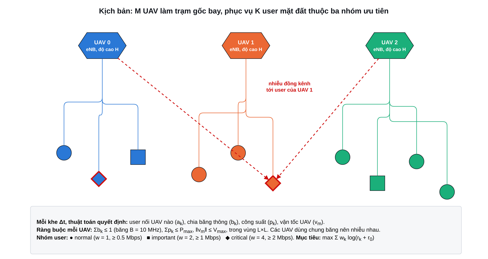

## Chương 3. Kiến trúc và thiết kế hệ thống

**Phải chứng minh:** hệ thống có cấu trúc rõ, mỗi thành phần có lý do tồn tại, và thiết kế kiểm chứng tách được lỗi mô
hình khỏi ảnh hưởng của giao thức.

| Mục | Hình / bảng | Nguồn |
|---|---|---|
| 3.1 Sơ đồ tổng thể | Hình 3.1 kiến trúc | `figures/kien_truc.png` |
| 3.2 Thành phần | Bảng 3.1 thành phần, công nghệ, vai trò | mục 3.2 `BAO_CAO_DU_AN.md` |
| 3.3 Luồng dữ liệu | Hai luồng: thí nghiệm (mô hình → kế hoạch → NS-3 → số đo) và thời gian thực (dashboard ↔ server ↔ Gazebo) | mục 3.3 |
| 3.4 Kiểm chứng ba tầng | Hình 3.2 ba tầng | `figures/ba_tang.png` |
| 3.5 Lựa chọn thiết kế | Bảng 3.2: quyết định, lý do, cái giá | mục 3.5 |
| 3.6 So sánh hệ thống | Bảng 3.3 so với bài báo, NS-3 thuần, phiên bản cũ | mục 3.6 |

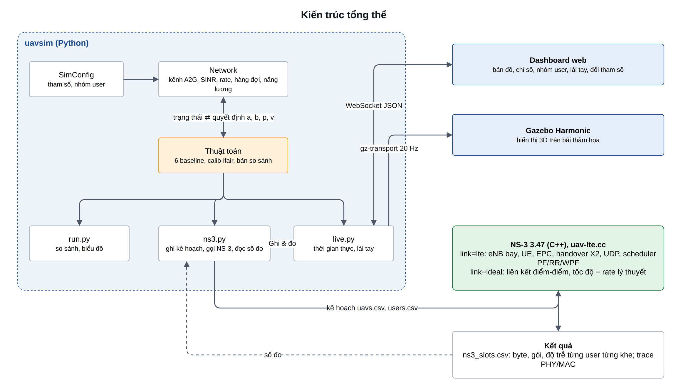

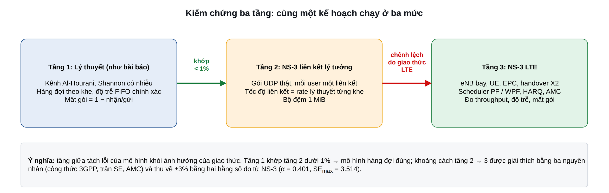

Bảng 3.2 nên viết dạng:

| Quyết định | Lý do | Cái giá |
|---|---|---|
| Thuật toán chạy trên mô hình, NS-3 chỉ phát lại | Mô hình nhanh hơn NS-3 LTE 3–4 bậc | Không có vòng phản hồi từ NS-3 |
| Viết lại kênh Al-Hourani trong C++ | Hai bên dùng cùng công thức (SINR lệch ≤ 0.1 dB) | Phải bảo trì hai bản |
| Trao đổi bằng CSV qua tiến trình con | Python bindings của NS-3 tắt; file kiểm tra và lưu được | Không tương tác lúc chạy |
| Scheduler WPF tự viết | PF gốc xóa tác dụng chia băng | Sửa mã nguồn NS-3 |
| Gazebo chỉ hiển thị, không PX4 | Quỹ đạo khớp tuyệt đối với mô hình | Không có động lực học bay |

## Chương 4. Mô hình toán học và phát biểu bài toán

**Phải chứng minh:** bài toán được phát biểu chặt, có ràng buộc, có lý do chọn hàm mục tiêu.

| Mục | Nội dung bắt buộc |
|---|---|
| 4.1–4.3 | Kịch bản, biến quyết định (a, b, p, q), Bảng 4.1 tham số (M=3, K=20, B=10 MHz, P=1 W, H=100 m, L=1000 m, V=20 m/s) |
| 4.4 | Giả thiết (độ cao cố định, đường xuống, suy hao trung bình) |
| 4.5–4.6 | Kênh Al-Hourani, SINR có nhiễu, ba công thức tốc độ: Shannon, 3GPP 36.942, LTE hiệu chỉnh (α = 0.401, trần 3.514) |
| 4.7–4.8 | Năng lượng bay, hàng đợi FIFO, định nghĩa mất gói |
| 4.9 | Bảng 4.2 chỉ số đánh giá: throughput, min throughput, Jain, coverage, độ trễ, mất gói, đạt QoS theo nhóm |
| 4.10 | Bài toán (P) tổng log có trọng số, ràng buộc C1–C5; Bảng 4.3 ba nhóm user (tỷ lệ 15/25/60%, w = 4/2/1, r_min = 2/1/0.5 Mbps) |

Định nghĩa **đạt QoS** phải viết đúng như code: tỷ lệ (user, khe) có throughput ≥ min(r_min của nhóm, 0.9 × lưu lượng
gửi).

## Chương 5. Triển khai hệ thống và giải thuật

| Mục | Hình / bảng | Nguồn |
|---|---|---|
| 5.1 Công nghệ | Bảng 5.1 công nghệ và phiên bản | mục 5.1 |
| 5.4 Baseline | Bảng 5.2: 6 baseline + kmeans-wmaxmin (baseline biết nhóm) | mục 5.4 |
| 5.5 calib-ifair | Hình 5.1 lưu đồ; ba khối; công thức b_k; ví dụ số 3 user | `figures/calib_ifair.png`, [`THUAT_TOAN_DE_XUAT.md`](THUAT_TOAN_DE_XUAT.md) |
| 5.7 Kịch bản NS-3 | Bảng 5.3 ánh xạ mô hình → NS-3; lưu đồ phát lại kế hoạch | mục 5.7 |
| 5.8 WPF | Công thức chỉ số WPF; phép thử 2 UE trọng số 0.8/0.2 → tỷ lệ 3.93 so với 4 | mục 5.8 |
| 5.9 Thời gian thực | Hình 5.2 kiến trúc, Hình 5.3 dashboard, Hình 5.4 Gazebo | `figures/thoi_gian_thuc.png`, `dashboard.png`, `gazebo.png` |
| 5.10 Giao thức mạng | Bảng cổng, bảng bản tin, bảng lệnh, sơ đồ trình tự, sơ đồ chồng giao thức LTE | mục 5.10 |
| 5.12 Kiểm thử | Bảng 5.4 nhóm test (46 test) | mục 5.12 |

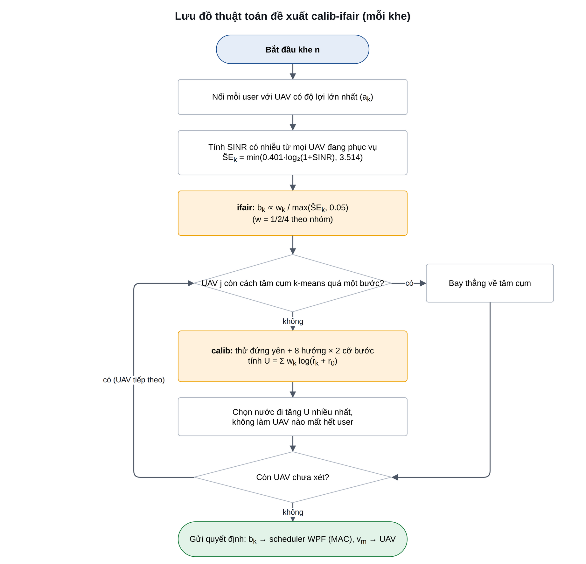

Khi trình bày calib-ifair, nêu đủ ba điều kiện để không bị bắt lỗi:

- Tỷ lệ tốc độ 1 : 2 : 4 trong một UAV chỉ đúng khi mọi user có SE ≥ 0.05; user có SE = 0 vẫn có tốc độ 0.
- Điều kiện "không giảm số UAV có user" chỉ áp ở pha tinh chỉnh, không áp ở pha bay về tâm cụm.
- Đây là heuristic: không bảo đảm tối ưu.

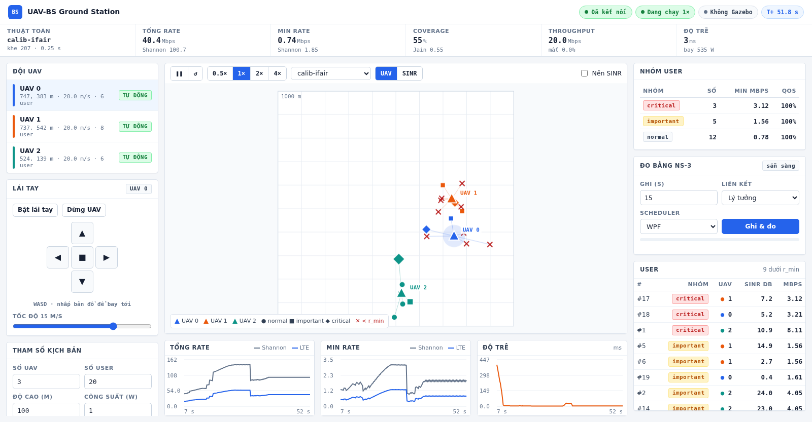

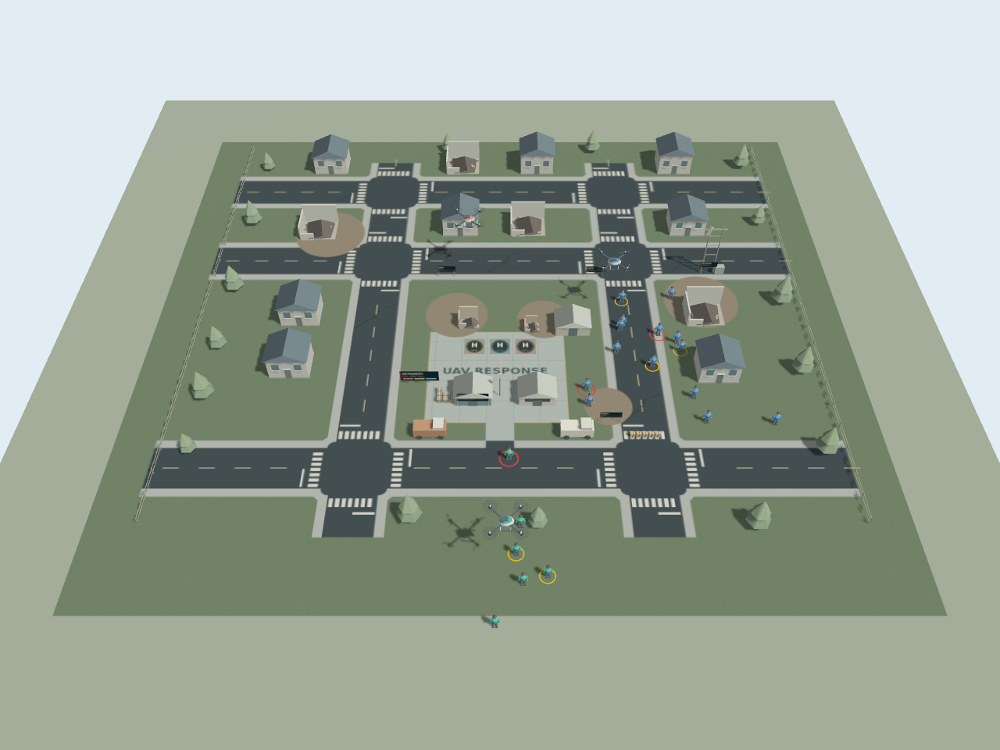

---

## Chương 6. Kết quả và đánh giá (chương chính)

### 6.0. Cách tổ chức chương

Chương đi theo một mạch lập luận, mỗi mục trả lời một câu hỏi và chuyển sang câu hỏi tiếp:

```
6.1 Thiết lập ──► 6.2 Mô hình nói gì? ──► 6.3 NS-3 có đồng ý không? (không hẳn: chỉ ~70%)
      ──► 6.4–6.5 Vì sao lệch? (giải thích hết, còn ±3%) ──► 6.6 Độ trễ, mất gói
      ──► 6.7 Chia băng chỉ có tác dụng ở tầng MAC ──► 6.8 Ba tầng: mô hình đúng ở mức gói tin
      ──► 6.9 Thuật toán đề xuất ──► 6.10 Ba nhóm user ──► 6.11 Chi phí tính toán ──► 6.12 Thời gian thực
      ──► 6.13 Tổng hợp
```

Mỗi mục viết theo khuôn: **câu hỏi → thiết lập → bảng → hình → đọc kết quả → kết luận một câu**.

### 6.1. Thiết lập thí nghiệm

**Bảng 6.1. Các thí nghiệm.**

| # | Thí nghiệm | Quy mô | Câu hỏi |
|---|---|---|---|
| E1 | Mô hình, 6 thuật toán | 6 × 3 seed × 200 khe | Theo lý thuyết, thuật toán nào tốt? |
| E2 | Ma trận NS-3 LTE theo tải | 3 thuật toán × 6 mức tải × 5 seed = 90 run | Đo ở mức gói tin thì sao? |
| E3 | Tách nhiễu, có trace PHY/MAC | 3 cấu hình × 3 seed | Vì sao LTE chỉ đạt ~70%? |
| E4 | Một liên kết, hiệu chỉnh, phân rã | 15 mức công suất; 24 run kiểm chứng | Nguyên nhân chênh lệch? |
| E5 | Lưu lượng và hàng đợi | 3 × 7 mức × 3 seed = 63 run | Độ trễ, mất gói lý thuyết so với LTE |
| E6 | Scheduler WPF | 2 × 7 × 3 = 42 run | Chia băng ở tầng MAC có tác dụng không? |
| E7 | Ba tầng | 105 run lý tưởng | Mô hình đúng ở mức gói tin không? |
| E8 | Thời gian chạy | | Chi phí tính toán |
| E9 | Thời gian thực | 40 khe; 20 khe với Gazebo | Lái tay, đồng bộ Gazebo, phát lại NS-3 có đúng không? |
| E10 | Thuật toán đề xuất | 3 × 7 × 3 = 63 run LTE + 63 run lý tưởng | Đề xuất có tốt hơn baseline không? |
| E11 | Ba nhóm user | 3 × 7 × 3 = 63 run LTE mới + dùng lại E5, E6, E10 | Có ưu tiên được critical không, giá phải trả? |
| E12 | Hiệu năng server WebSocket | 1–50 client × 20 s | Bản tin, băng thông, độ trễ lệnh, khả năng mở rộng |

**Bảng 6.2. Cấu hình chung của các thí nghiệm NS-3.**

| Tham số | Giá trị |
|---|---|
| Số UAV / user | 3 / 20, phân bố theo cụm, vùng 1000 × 1000 m |
| Độ cao, công suất | 100 m, 1 W (30 dBm) |
| Băng thông | 10 MHz (50 resource block), mọi eNB cùng tần số |
| Kênh | Al-Hourani, đô thị, 2 GHz |
| Số khe, độ dài khe | 60 khe × 1 s |
| Lưu lượng | UDP đường xuống, 0.5 / 1 / 1.5 / 2 / 2.5 / 3 / 4 Mbps mỗi user |
| Bộ đệm | RLC UM 1 MiB |
| Scheduler | PF (mặc định), WPF (trọng số b_k) |
| Seed | 3 (E5–E11), 5 (E2) |

### 6.2. Kết quả của mô hình (E1)

**Câu hỏi:** theo lý thuyết (Shannon), cách di chuyển và cách chia băng nào tốt?

**Bảng 6.3. Kết quả mô hình, Shannon, 200 khe, trung bình 3 seed (số tính).**

| Thuật toán | Sum rate (Mbps) | Min rate (Mbps) | Jain | Coverage | Năng lượng (J/khe) |
|---|---|---|---|---|---|
| hover-equal | 87 ± 38 | 0.71 | 0.47 | 77% | 505.5 |
| hover-maxmin | 76 ± 30 | 0.84 | 0.51 | 80% | 505.5 |
| kmeans-equal | 145 ± 22 | 1.85 | 0.71 | 99.4% | 507.8 |
| kmeans-maxmin | 143 ± 22 | 1.90 | 0.72 | 99.6% | 507.8 |
| random-equal | 97 ± 33 | 1.01 | 0.64 | 89% | 534.9 |
| random-maxmin | 89 ± 31 | 1.25 | 0.69 | 93% | 534.9 |

**Hình 6.1.** So sánh 6 thuật toán trên mô hình.

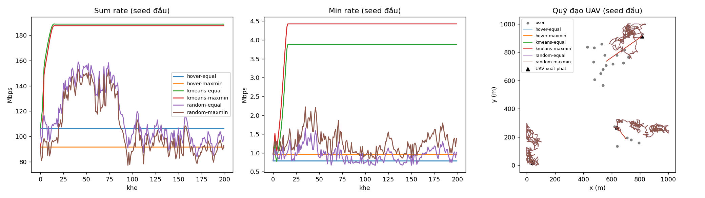

**Kết luận:** di chuyển có định hướng (kmeans) là yếu tố quyết định: sum rate ×1.7, min rate ×2.6, coverage 77% → 99%
so với đứng yên, năng lượng gần như không đổi.

### 6.3. Đo bằng NS-3 LTE theo tải (E2)

**Câu hỏi:** đo ở mức gói tin thì kết luận trên còn đúng không, và mạng chịu tải tới đâu?

**Bảng 6.4. NS-3 LTE theo tải, 60 khe, 5 seed (số đo).**

| Thuật toán | Tải | Gửi (Mbps) | Nhận (Mbps) | Chuyển được | Độ trễ | Mất gói | Min (Mbps) |
|---|---|---|---|---|---|---|---|
| hover-equal | 0.5 | 22.6 | 22.6 | 100% | 11 ms | 0.03% | 0.23 |
| | 1.0 | 45.3 | 31.6 | 69% | 4.5 s | 31% | 0.26 |
| kmeans-equal | 0.5 | 37.1 | 37.1 | 100% | 9 ms | 0.02% | 0.48 |
| | 0.7 | 52.0 | 50.0 | 96% | 0.8 s | 4.1% | 0.57 |
| | 1.0 | 74.3 | 52.8 | 71% | 2.6 s | 29% | 0.57 |
| kmeans-maxmin | 1.0 | 73.0 | 52.7 | 72% | 2.5 s | 28% | 0.57 |

**Hình 6.2.** Throughput, độ trễ, mất gói theo tải trên NS-3 LTE.

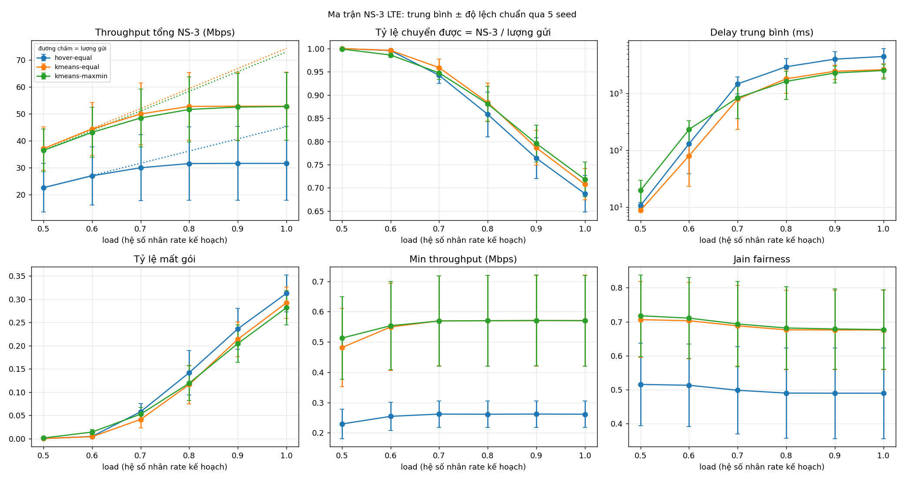

**Đọc kết quả:** kmeans hơn hover khoảng 2.2 lần về min throughput ở cả 5 seed (khớp mô hình). Nhưng LTE chỉ chuyển
được khoảng 70% so với công thức 3GPP; độ trễ gãy giữa tải 0.6 và 0.7. maxmin chia ở tầng ứng dụng cho kết quả trùng
equal ở tải cao.

**Kết luận:** thứ hạng của lý thuyết đúng, giá trị tuyệt đối thì lạc quan; nên chỉ lập kế hoạch 50–60% tốc độ tính được.

### 6.4. Tìm nguyên nhân chênh lệch (E3, E4)

**Bảng 6.5. Ba cấu hình kmeans-equal tải 1.0 (số đo, trace PHY/MAC).**

| | A. chung tần số | B. tần số riêng | C. 1 UAV |
|---|---|---|---|
| Mô hình 3GPP (Mbps) | 76.3 | 103.9 | 43.4 |
| NS-3 (Mbps) | 57.1 | 80.8 | 33.7 |
| NS-3 / mô hình | 0.75 | 0.78 | 0.78 |
| SINR trung vị (dB) | 19.7 | 42.0 | 38.7 |
| MCS trung bình | 21.7 | 28.0 | 27.8 |
| Lỗi khối lần đầu | 0.06% | 0.02% | 0.05% |

**Bảng 6.6. Bốn giả thuyết và kết quả kiểm tra.**

| Giả thuyết | Kiểm tra | Kết quả |
|---|---|---|
| (a) Kênh cài khác nhau | So SINR NS-3 với SNR mô hình | Loại: lệch ≤ 0.1 dB |
| (b) Mô hình tính nhiễu sai | So SINR từng khe, từng user | Loại: lệch trung vị ≤ 0.22 dB |
| (c) Do HARQ, lỗi truyền | Tỷ lệ lỗi khối | Loại: < 0.1% |
| (d) LTE đổi SINR ra tốc độ khác công thức | Khớp đường cong một liên kết | **Đúng**: α = 0.401, trần 3.514 → NS-3/mô hình = 1.02 / 0.99 / 1.00 |

**Hình 6.3.** Đường cong hiệu suất phổ theo SINR của một liên kết: Shannon, 3GPP, NS-3 đo, đường khớp.

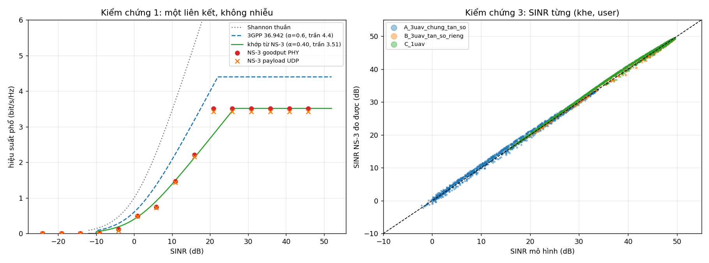

### 6.5. Phân rã khoảng cách Shannon → NS-3

**Bảng 6.7. Throughput qua từng bậc, tải 1.0 (Mbps).**

| Bậc | A | B | C | hover-equal | kmeans-equal | kmeans-maxmin |
|---|---|---|---|---|---|---|
| ① Shannon | 146.9 | 321.2 | 121.7 | 80.3 | 132.6 | 129.9 |
| ② 3GPP 36.942 | 76.3 | 103.9 | 43.4 | 45.3 | 74.3 | 73.0 |
| ③ + trần LTE 3.51 | 66.2 | 83.2 | 35.1 | 42.1 | 68.1 | 67.2 |
| ④ + độ dốc LTE 0.40 | 56.0 | 81.9 | 33.6 | 31.5 | 52.1 | 51.1 |
| ⑤ NS-3 đo | 57.0 | 80.8 | 33.7 | 31.6 | 52.8 | 52.7 |
| ⑤ / ① | 0.39 | 0.25 | 0.28 | 0.39 | 0.40 | 0.41 |
| ⑤ / ④ | 1.02 | 0.99 | 1.00 | 1.00 | 1.01 | 1.03 |

**Hình 6.4.** Biểu đồ thác nước phân rã.

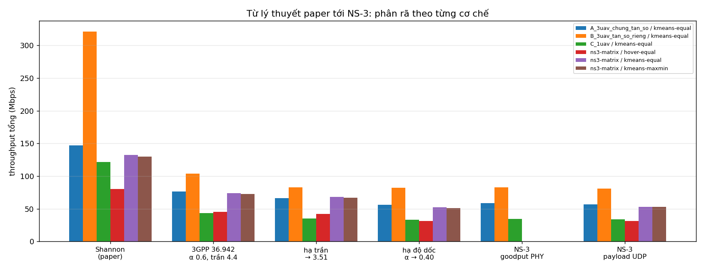

**Kết luận:** NS-3 LTE chỉ bằng 25–40% Shannon, và khoảng cách được giải thích hoàn toàn bằng ba đặc điểm của LTE; mô
hình hiệu chỉnh dự đoán NS-3 với sai số khoảng ±3%.

### 6.6. Độ trễ và mất gói (E5)

**Bảng 6.8. kmeans-equal, PF, 3 seed: lý thuyết (Shannon) / NS-3 LTE.**

| Mbps/user | Throughput (Mbps) | Độ trễ (ms) | Mất gói |
|---|---|---|---|
| 0.5 | 10.0 / 10.0 | 2 / 7 | 0% / 0% |
| 1 | 20.0 / 19.6 | 17 / 152 | 0% / 2.2% |
| 2 | 39.5 / 33.9 | 279 / 1397 | 1.3% / 15.2% |
| 4 | 71.6 / 49.9 | 749 / 2173 | 10.5% / 37.6% |

**Bảng 6.9. Sai số của lý thuyết khi thêm từng đặc điểm LTE (63 run).**

| Lý thuyết | Sai số throughput | Sai số mất gói | Độ trễ, lệch trung vị |
|---|---|---|---|
| Như bài báo | 27.3% | 15.1 điểm % | ×3.7 |
| + đổi SINR ra tốc độ kiểu LTE | 3.5% | 2.7 điểm % | ×1.21 |
| + chia băng linh hoạt | 4.9% | 3.6 điểm % | ×1.23 |
| + nhiễu theo tải | 4.4% | 3.2 điểm % | ×1.16 |

**Hình 6.5.** Độ trễ và mất gói: lý thuyết so với NS-3 LTE.

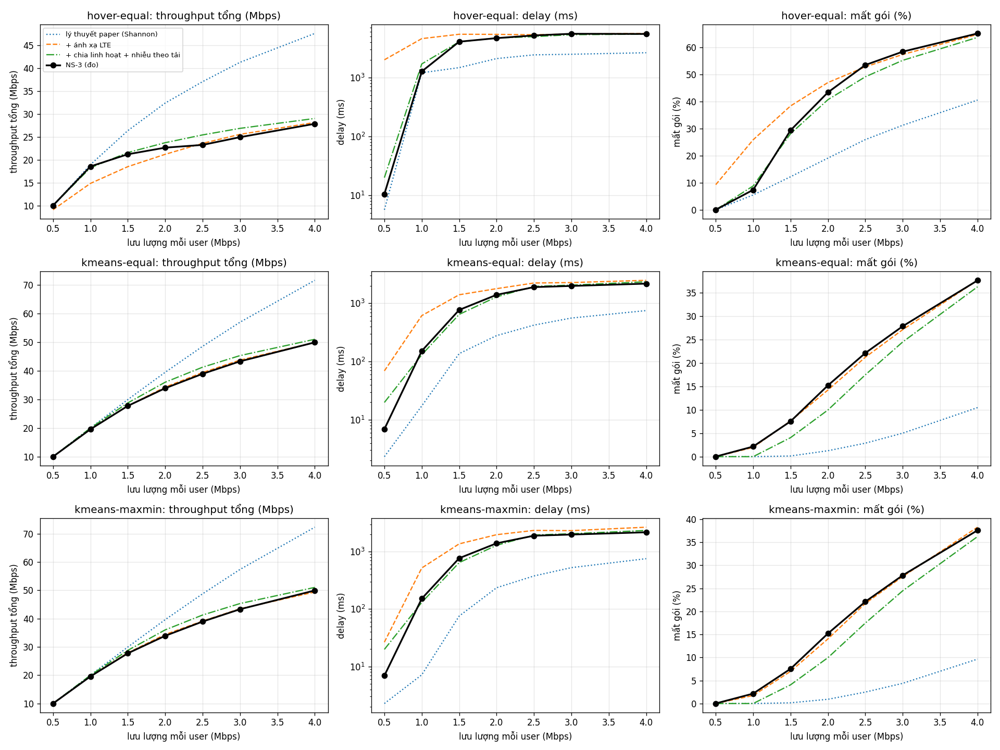

**Kết luận:** lý thuyết kiểu bài báo lạc quan 3–9 lần về độ trễ; thêm cách đổi SINR của LTE là sửa được phần lớn.

### 6.7. Chia băng ở tầng MAC (E6)

**Bảng 6.10. maxmin với WPF so với equal (số đo, 3 seed; trong ngoặc: lý thuyết dự đoán).**

| | Mbps/user | Min throughput equal → maxmin | Throughput tổng |
|---|---|---|---|
| hover | 1 | 0.57 → 0.67 (+18%, 3/3; dự đoán +18%) | 18.5 → 19.0 |
| hover | 4 | 0.26 → 0.30 (+16%, 3/3; dự đoán +18%) | 27.8 → 26.5 |
| kmeans | 1 | 0.84 → 0.85 (+1%, 3/3; dự đoán +2%) | 19.6 → 19.6 |
| kmeans | 4 | 0.67 → 0.74 (+11%, 3/3; dự đoán +11%) | 49.9 → 49.7 |

**Kết luận:** maxmin thắng ở cả 18 cặp, mức tăng bám sát lý thuyết. Chia băng có tác dụng **chỉ khi áp ở tầng MAC**; ở
tầng ứng dụng thì PF xóa mất (mục 6.3). Với kmeans, tác dụng chỉ rõ khi mạng đã nghẽn.

### 6.8. Kiểm chứng ba tầng (E7)

**Bảng 6.11. Lý thuyết / NS-3 liên kết lý tưởng, 3 seed.**

| Thuật toán | Mbps/user | Throughput (Mbps) | Độ trễ (ms) | Mất gói (%) |
|---|---|---|---|---|
| hover-equal | 1 | 18.90 / 18.90 | 1202.5 / 1201.6 | 5.49 / 5.50 |
| | 4 | 47.54 / 47.54 | 2634.0 / 2631.1 | 40.58 / 40.58 |
| kmeans-equal | 1 | 20.00 / 20.00 | 17.3 / 17.5 | 0.00 / 0.00 |
| | 4 | 71.63 / 71.63 | 749.2 / 748.4 | 10.46 / 10.47 |
| kmeans-maxmin | 1 | 20.00 / 20.00 | 7.2 / 7.2 | 0.00 / 0.00 |
| | 4 | 72.29 / 72.29 | 754.0 / 753.1 | 9.64 / 9.64 |

Sai số lớn nhất trên 105 run: throughput 0.02%, độ trễ 1.0%, mất gói 0.014 điểm %.

**Hình 6.6, 6.7.** Ba tầng với scheduler PF và WPF (xanh dương: lý thuyết; vòng cam: NS-3 lý tưởng; xanh lá: NS-3 LTE).

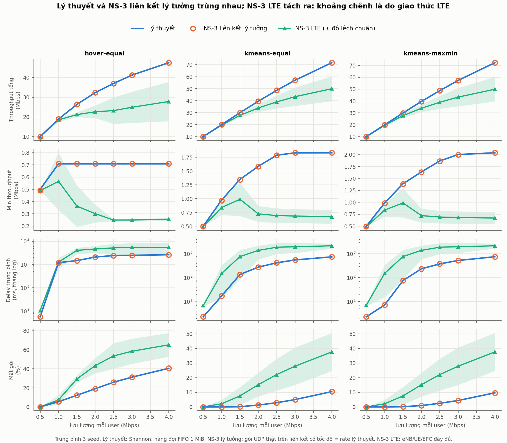

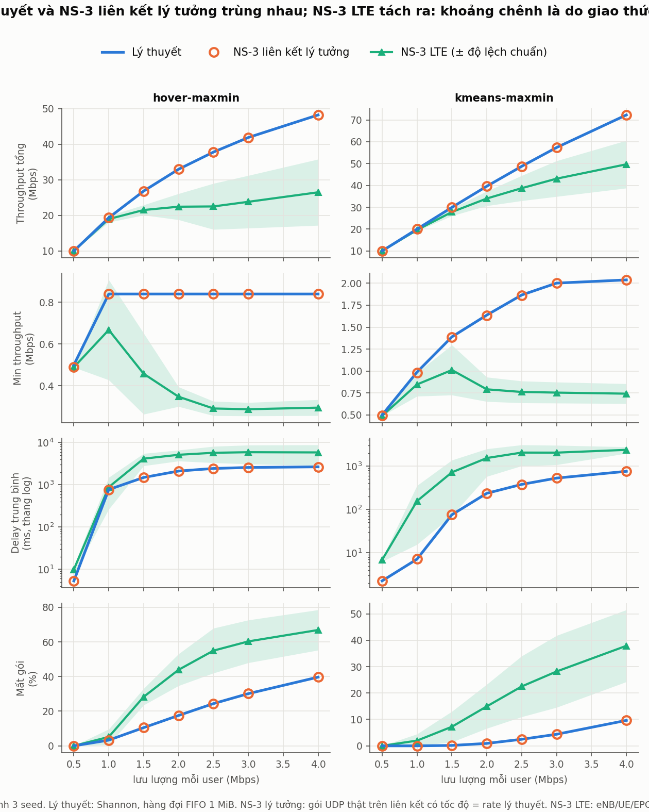

**Kết luận:** vòng cam nằm đúng trên đường lý thuyết ở mọi ô, nên mô hình hàng đợi và đường ống đo đều đúng; mọi
chênh lệch còn lại là do giao thức LTE.

### 6.9. Thuật toán đề xuất trên NS-3 LTE (E10)

**Câu hỏi:** calib-ifair có hơn baseline không, và lợi ích đến từ khối nào?

**Thiết lập:** mọi user cùng nhóm (w = 1), WPF, 3 seed, so theo cặp với kmeans-equal. Hai bản tách thành phần:
kmeans-ifair (chỉ chia băng mới) và calib-equal (chỉ di chuyển mới).

**Bảng 6.12. Min throughput theo lưu lượng (Mbps, số đo; trong ngoặc: tỷ lệ so với kmeans-equal, số seed thắng).**

| Mbps/user | kmeans-equal | kmeans-maxmin | kmeans-ifair | calib-equal | **calib-ifair** |
|---|---|---|---|---|---|
| 1 | 0.84 | 0.85 (×1.01) | 0.92 (×1.11) | 0.90 (×1.09) | **0.95 (×1.16, 3/3)** |
| 2 | 0.72 | 0.79 (×1.10) | 1.29 (×1.77) | 0.80 (×1.10) | **1.37 (×1.92, 3/3)** |
| 4 | 0.67 | 0.74 (×1.11) | 1.27 (×1.87) | 0.75 (×1.09) | **1.37 (×2.03, 3/3)** |

**Bảng 6.13. Các chỉ số còn lại.**

| Chỉ số | Mbps/user | kmeans-equal | kmeans-maxmin | kmeans-ifair | calib-equal | **calib-ifair** |
|---|---|---|---|---|---|---|
| Throughput tổng (Mbps) | 1 | 19.6 | 19.6 | 19.8 | 19.8 | **19.9** |
| | 2 | 33.9 | 34.0 | 33.4 | 35.3 | **34.8** |
| | 4 | 49.9 | 49.7 | 46.1 | 52.2 | **48.2** |
| Độ trễ (ms) | 1 | 152 | 156 | 165 | 57 | **72** |
| | 2 | 1397 | 1524 | 2174 | 1152 | **1837** |
| Mất gói (%) | 1 | 2.2 | 2.0 | 1.3 | 1.2 | **0.5** |
| | 4 | 37.6 | 37.9 | 42.3 | 34.8 | **39.7** |

**Hình 6.8.** Bốn chỉ số theo lưu lượng cho 5 thuật toán, NS-3 LTE, 3 seed.

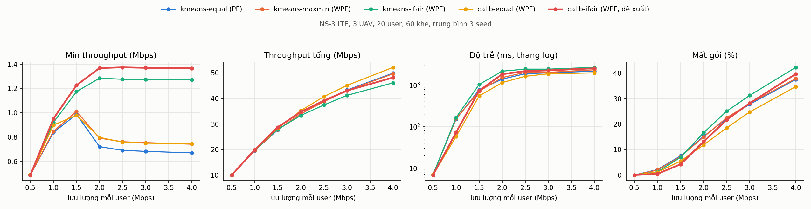

**Đọc hình:** ở ô min throughput, đường đỏ (calib-ifair) và xanh lá (kmeans-ifair) tách hẳn lên trên từ 1.5 Mbps/user,
các đường còn lại dính nhau quanh 0.7–0.8 Mbps. Ở ô throughput tổng, các đường gần như trùng nhau.

**Kết luận:** ở tải ≥ 2 Mbps/user, calib-ifair nâng min throughput gần gấp đôi (×1.92–2.03, 3/3 seed) mà throughput tổng
giữ trong ±4%. Phần lớn lợi ích đến từ ifair; calib bù lại throughput tổng và mất gói mà ifair làm giảm. Đánh đổi: độ
trễ trung bình ở tải cao tăng.

### 6.10. Ba nhóm user (E11)

**Câu hỏi:** có ưu tiên được user critical không, có hơn một baseline cùng biết nhóm không, và giá phải trả là gì?

**Thiết lập:** 3 critical, 5 important, 12 normal mỗi seed (w = 4/2/1). Baseline biết nhóm: **kmeans-wmaxmin** (max-min
có trọng số, SNR không nhiễu). calib-ifair-noclass bỏ qua nhóm; calib-ifair-shannon thay đường cong LTE bằng Shannon.

**Bảng 6.14. Kết quả theo nhóm, NS-3 LTE, WPF, 3 seed (số đo).**

| Mbps/user | Chỉ số | kmeans-equal | kmeans-maxmin | calib-ifair-noclass | kmeans-wmaxmin | calib-ifair-shannon | **calib-ifair** |
|---|---|---|---|---|---|---|---|
| 1 | Critical đạt QoS | 92% | 91% | 96% | 100% | 100% | **100%** |
| 1 | Độ trễ critical (ms) | 208 | 220 | 65 | 5 | 6 | **6** |
| 2 | Critical đạt QoS | 69% | 69% | 65% | 87% | 98% | **97%** |
| 2 | Min throughput critical (Mbps) | 1.27 | 1.30 | 1.52 | 1.80 | 1.96 | **1.97** |
| 2 | Độ trễ critical (ms) | 1084 | 1328 | 1569 | 252 | 41 | **41** |
| 2 | Min throughput normal (Mbps) | 0.73 | 0.81 | 1.39 | 0.59 | 1.01 | **1.02** |
| 2 | Throughput tổng (Mbps) | 33.9 | 34.0 | 34.8 | 31.8 | 32.5 | **32.4** |
| 4 | Critical đạt QoS | 69% | 66% | 59% | 86% | 96% | **96%** |
| 4 | Min throughput critical (Mbps) | 1.64 | 1.67 | 1.63 | 2.79 | 3.24 | **3.25** |
| 4 | Độ trễ critical (ms) | 2062 | 2334 | 2344 | 652 | 722 | **720** |
| 4 | Min throughput normal (Mbps) | 0.68 | 0.76 | 1.40 | 0.49 | 0.94 | **0.95** |
| 4 | Throughput tổng (Mbps) | 49.9 | 49.7 | 48.2 | 44.3 | 44.2 | **44.1** |
| 4 | Mất gói (%) | 37.6 | 37.9 | 39.7 | 44.6 | 44.8 | **44.8** |

**Hình 6.9.** Critical đạt QoS, min throughput critical và normal, throughput tổng theo lưu lượng.

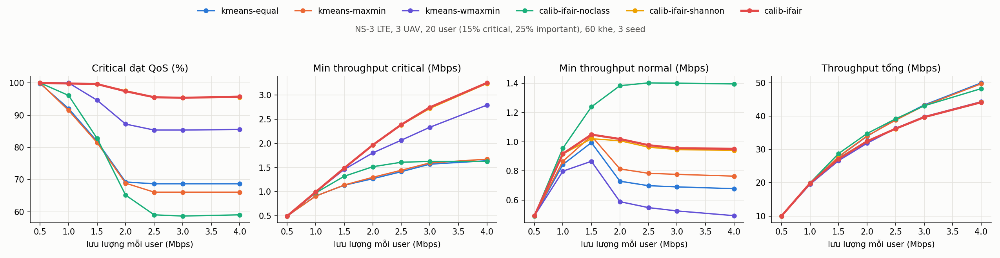

**Đọc hình:** ở ô đầu tiên, ba baseline không biết nhóm rơi xuống 59–69% từ 2 Mbps/user; kmeans-wmaxmin (tím) dừng ở
86–87%; calib-ifair (đỏ) và bản Shannon (vàng, nằm đè lên) giữ trên 95%. Ở ô min throughput normal, kmeans-wmaxmin
thấp nhất: nó ưu tiên critical bằng cách bỏ đói normal. Ở ô throughput tổng, hai thuật toán biết nhóm thấp hơn khoảng
11% ở 4 Mbps/user: đó là giá phải trả.

**Hình 6.10.** Cùng kịch bản, hai cách làm: kmeans-equal (trên) và calib-ifair (dưới) ở khe 0, 10, 59; hình thoi viền
đỏ là user critical, dấu × là user chưa đạt QoS.

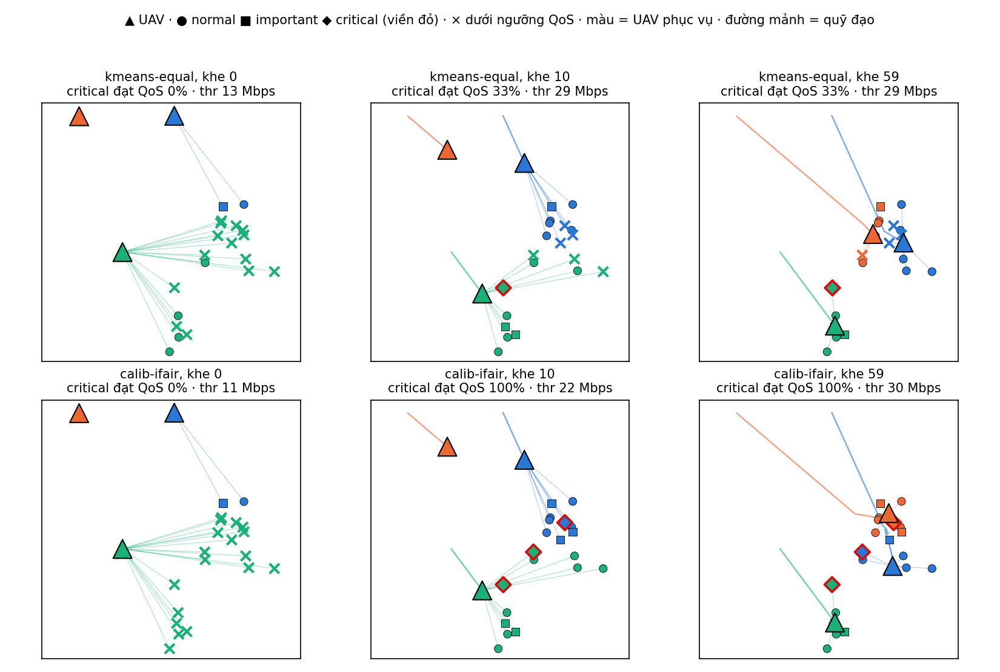

**Bốn kết luận phải viết ra:**

1. Biết nhóm là điều kiện cần: baseline không biết nhóm chỉ cho 59–69% critical đạt QoS.
2. Cùng biết nhóm, calib-ifair hơn max-min có trọng số: 96–97% so với 86–87% critical đạt QoS, min throughput normal
   gần gấp đôi (0.95 so với 0.49 Mbps ở 4 Mbps/user), throughput tổng như nhau. Riêng độ trễ critical ở 4 Mbps/user,
   kmeans-wmaxmin thấp hơn một chút (652 so với 720 ms): phải ghi trung thực.
3. Giá phải trả so với baseline không biết nhóm: throughput tổng giảm 4–12%, mất gói tăng.
4. Đường cong LTE không tạo ra khác biệt (bản Shannon trùng trong 1–2%); lợi ích đến từ tính nhiễu, tinh chỉnh vị
   trí, áp ở tầng MAC và mục tiêu có trọng số.

### 6.11. Chi phí tính toán (E8)

**Bảng 6.15. Thời gian một khe của mô hình.**

| Cấu hình | Thời gian mỗi khe |
|---|---|
| kmeans-equal, 3 UAV, 20 user | 0.83 ms |
| kmeans-equal, có lưu lượng | 3.02 ms |
| kmeans, 10 UAV, 100 user | 2.67 ms |
| calib-ifair, 3 UAV, 20 user | 5.5 ms |
| calib-ifair, 8 UAV, 60 user | 13.6 ms |
| NS-3 LTE, một run 60 khe | trung vị 254 s |

**Kết luận:** calib-ifair cần dưới 14 ms trong khi một khe dài 250 ms ở chế độ thời gian thực; mô hình nhanh hơn NS-3
LTE 3–4 bậc, nên thiết kế "thuật toán trên mô hình, NS-3 để đo" là hợp lý.

### 6.12. Điều khiển thời gian thực (E9)

Viết dạng bảng kiểm, mỗi dòng một yêu cầu và kết quả đo:

**Bảng 6.16. Kiểm tra trạm điều khiển thời gian thực.**

| Yêu cầu | Cách kiểm tra | Kết quả |
|---|---|---|
| Lái tay đúng vận tốc, có giới hạn | Lệnh 30 m/s, 40 khe | Đi đúng 200 m (= V_max × 0.25 s × 40); UAV khác vẫn theo thuật toán |
| Đủ nhanh | Thời gian một khe | 3.4 ms trung bình, 3.9 ms tối đa (khe 250 ms) |
| Gazebo đồng bộ | So vị trí UAV trong Gazebo với mô hình, 20 khe | Lệch lớn nhất 0.000 m |
| Phiên ghi phát lại được trong NS-3 | Ghi 40 khe rồi phát lại, WPF | Lý tưởng: 19.99 so với 20.0 Mbps, mất 0.04%; LTE: 19.72 Mbps, trễ 134 ms |
| An toàn | Gửi lệnh sai; ngắt kết nối; tắt server | Server không sập; UAV lái tay dừng; Gazebo đóng theo |

**Bảng 6.16b. Hiệu năng server WebSocket (E12).** Lấy bảng E12 ở mục 6.10 của `BAO_CAO_DU_AN.md`
(`experiments/results/websocket.csv`). **Kết luận:** 50 client, nhịp khe giữ 251 ms, lệnh khứ hồi < 3.5 ms (p95),
9.4 kB/s mỗi client, CPU 3.5%: server một luồng asyncio chưa phải nút cổ chai. Đây là kết quả trực tiếp nhất cho phần
lập trình mạng của môn học.

### 6.13. Tổng hợp

**Bảng 6.17. Kết luận nào của lý thuyết đứng vững trên NS-3.** Lấy nguyên bảng mục 6.13 của `BAO_CAO_DU_AN.md`. Đây là
bảng nên đưa lên slide kết luận.

---

## Chương 7. Kết luận và hướng phát triển

| Mục | Nội dung |
|---|---|
| 7.1 Kết quả đạt được | 4–5 gạch đầu dòng, mỗi dòng một con số: ba tầng khớp < 1%; khoảng cách Shannon → LTE giải thích hết, còn ±3%; calib-ifair min throughput ×1.92–2.03; critical đạt QoS 96–97% so với 86–87% của baseline biết nhóm; điều khiển thời gian thực đồng bộ 0.000 m |
| 7.2 Hạn chế | Một topology (3 UAV, 20 user), 3 seed; NS-3 không phản hồi cho thuật toán; r_min chưa là ràng buộc cứng; trọng số nhóm chọn tay; chưa có baseline tối ưu lồi; Gazebo không có PX4 |
| 7.3 Hướng phát triển | Mở rộng ma trận NS-3 (nhiều seed, nhiều topology); DRL đo bằng NS-3; baseline BCD + SCA; vòng kín qua ns3-gym; PX4 SITL |

## Phụ lục

| Phụ lục | Nội dung | Nguồn |
|---|---|---|
| A | Bảng ký hiệu | Phụ lục A `BAO_CAO_DU_AN.md` |
| B | Danh mục hình (19 hình, bảng dưới) | |
| C | Tái lập kết quả (nếu được phép) | Phụ lục C `BAO_CAO_DU_AN.md` |

### Danh mục hình đầy đủ

| Hình | Nội dung | File | Tình trạng |
|---|---|---|---|
| 2.1 | Kịch bản | `docs/figures/kich_ban.png` | Có |
| 3.1 | Kiến trúc tổng thể | `docs/figures/kien_truc.png` | Có |
| 3.2 | Ba tầng kiểm chứng | `docs/figures/ba_tang.png` | Có |
| 5.1 | Lưu đồ calib-ifair | `docs/figures/calib_ifair.png` | Có, đã cập nhật |
| 5.2 | Kiến trúc thời gian thực | `docs/figures/thoi_gian_thuc.png` | Có |
| 5.3 | Dashboard | `docs/figures/dashboard.png` | Có, đã chụp lại |
| 5.4 | Gazebo | `docs/figures/gazebo.png` | Có |
| 5.5 | Lưu đồ phát lại kế hoạch NS-3 | `docs/figures/phat_lai_ns3.png` | Có |
| 5.6 | Sơ đồ trình tự WebSocket | `docs/figures/giao_thuc_ws.png` | Có |
| 5.7 | Chồng giao thức LTE | `docs/figures/chong_giao_thuc.png` | Có |
| 6.1 | Kết quả mô hình | `experiments/results/demo/compare.png` | Có |
| 6.2 | NS-3 theo tải | `experiments/results/ns3-matrix/ns3_matrix.png` | Có |
| 6.3 | Đường cong một liên kết | `experiments/results/validation/validation.png` | Có |
| 6.4 | Phân rã Shannon → NS-3 | `experiments/results/validation/decomposition.png` | Có |
| 6.5 | Lý thuyết so với NS-3 LTE | `experiments/results/ns3-demand-lte/theory_vs_ns3.png` | Có |
| 6.6 | Ba tầng, PF | `experiments/results/three_tier_pf.png` | Có |
| 6.7 | Ba tầng, WPF | `experiments/results/three_tier_wpf.png` | Có |
| 6.8 | Thuật toán đề xuất | `experiments/results/proposed.png` | Có |
| 6.9 | Ba nhóm user | `experiments/results/classes.png` | Có |
| 6.10 | Ảnh chụp hai thuật toán | `docs/figures/snapshots.png` | Có |

## Danh sách việc trước khi nộp

- [x] Chụp lại Hình 5.3 (dashboard mới).
- [x] Vẽ Hình 5.5, 5.6, 5.7 bằng draw.io.
- [x] Đo lại Bảng 6.16 với khe 0.25 s.
- [ ] Kiểm tra mọi bảng ghi đủ cấu hình, số seed, số tính hay số đo.
- [ ] Kiểm tra ba điều kiện của calib-ifair (mục Chương 5) được nêu đúng.
- [ ] Đánh số hình, bảng liên tục; mọi hình đều được nhắc tới trong văn bản.
- [ ] Xóa dòng lệnh khỏi thân báo cáo; đếm số trang ≤ 100.

---

## Phụ lục. Ghi chú cũ cho người viết báo cáo và làm slide

(Chuyển từ Phụ lục D của `BAO_CAO_DU_AN.md` để báo cáo nộp không chứa phần này.)

### 1. Yêu cầu của tiêu chí cần nhớ

Báo cáo không quá 100 trang A4 và không chứa code; dùng mã giả, lưu đồ, công thức và bảng. Các dòng lệnh ở Phụ lục C
và tên hàm, tên file trong tài liệu này là để người viết tra cứu, không chép vào báo cáo; trong báo cáo chỉ cần nói
"kết quả tái lập được, mỗi thí nghiệm lưu kèm cấu hình". Kết luận cải tiến phải có số
liệu hoặc lập luận có căn cứ, và nên có ít nhất một phương pháp tham chiếu để so sánh (ở đây là hover-equal và lý thuyết
theo kiểu bài báo). Khi dùng giải pháp có sẵn (kmeans, scheduler PF, mô hình Al-Hourani) cần nêu lý do chọn và ưu,
nhược điểm.

### 2. Phân bổ số trang gợi ý

| Chương | Điểm | Số trang | Hình, bảng nên có |
|---|---|---|---|
| 1. Đóng góp | 5 | 1 | Bảng phân công |
| 2. Cấp thiết | 10 | 5–7 | Hình 1, bảng so sánh cách làm hiện có |
| 3. Kiến trúc | 15 | 10–12 | Hình 2, 3, 5; bảng so sánh hệ thống |
| 4. Mô hình toán | 15 | 12–15 | Bảng tham số, bảng hằng số, ví dụ số |
| 5. Triển khai | 20 | 15–18 | Mã giả 5.3–5.6, lưu đồ 5.7, hình 4, 6, 7 |
| 6. Hiệu năng | 25 | 25–30 | Hình 8–16 và các bảng chương 6 |
| 7. Kết luận | 5 | 2–3 | Bảng mức độ hoàn thành |
| Tài liệu tham khảo, phụ lục | 5 | 3–5 | |

### 3. Những điểm nên nhấn mạnh

Năm ý chính xuyên suốt: (0) thuật toán đề xuất calib-ifair với ba nhóm user: nâng min throughput gần gấp đôi trên NS-3
LTE mà giữ throughput tổng, và khi có nhóm thì đưa tỷ lệ user critical đạt QoS từ 59–69% lên 96–97% với giá throughput
tổng giảm 4–12%, và hơn cả max-min có trọng số cùng biết nhóm. Đây là phần cải tiến chính; nên gọi là "heuristic cải
tiến", không gọi là "thuật toán mới" hay "thuật toán tối ưu", vì các thành phần đều dựa trên kỹ thuật đã có. Cần nói
trung thực rằng lợi ích đến từ việc tính nhiễu, tinh chỉnh vị trí, áp ở MAC và trọng số nhóm; bản dùng Shannon thay đường cong LTE cho kết quả như nhau (mục 6.12); (1) kết quả đo bằng giao thức thật chỉ bằng 25–40% con số Shannon mà các bài báo dùng; (2) nhờ
tầng liên kết lý tưởng, nhóm chứng minh được mô hình đúng (sai số dưới 1%), nên khoảng chênh là do LTE và đã được giải
thích bằng ba nguyên nhân; (3) thứ hạng giữa các thuật toán vẫn đúng, còn việc chia băng thông chỉ có tác dụng khi áp ở
tầng MAC; (4) hệ thống điều khiển thời gian thực đồng bộ hoàn toàn với mô hình và ghi phiên lại để đo được.

Khi viết chương 6, nên nói rõ số liệu là tính hay đo, ghi đơn vị và số seed, và so sánh thuật toán theo cặp trên cùng
seed. Các sơ đồ ASCII trong tài liệu này nên được vẽ lại bằng draw.io. Thông tin xuất bản của tài liệu tham khảo cần đối
chiếu lại với bản gốc, và nên bổ sung vài bài báo gần đây (2021–2025) về UAV làm trạm gốc dùng học tăng cường hoặc tối
ưu cho chương 2.

### 4. Dàn ý slide (khoảng 20 slide, 15–20 phút)

| # | Slide | Nội dung | Hình |
|---|---|---|---|
| 1 | Tiêu đề | Tên đề tài, nhóm, giảng viên | |
| 2 | Bối cảnh | Thiên tai, sự kiện đông người, UAV mang trạm gốc | Ảnh minh họa |
| 3 | Vấn đề | Bài báo chỉ tính bằng Shannon; con số thật là bao nhiêu? | |
| 4 | Mục tiêu | Sáu mục tiêu ở mục 2.3 | |
| 5 | Kịch bản | M UAV, K user, nhiễu, khe thời gian | Hình 1 |
| 6 | Mô hình kênh | Al-Hourani; từ 100 m lên 300 m mất 20 dB | |
| 7 | Tốc độ, năng lượng, hàng đợi | Ba công thức chính, độ trễ FIFO | |
| 8 | Bài toán tối ưu | Ba nhóm user, max Σ w log r, ràng buộc mỗi UAV, tính không lồi; mục tiêu và cách chấm điểm tách riêng | |
| 9 | Kiến trúc | | Hình 2 |
| 10 | Ba tầng kiểm chứng | Vai trò của tầng giữa | Hình 3 |
| 11 | Thuật toán | Sáu baseline, kmeans, maxmin | |
| 12 | NS-3 và WPF | Ánh xạ mô hình sang NS-3, scheduler có trọng số | Hình 4 |
| 13 | Kết quả mô hình | kmeans tăng sum rate 1.7 lần, min rate 2.6 lần | Hình 8 |
| 14 | NS-3 chịu tải | Đạt khoảng 70% công thức 3GPP; nên gửi 50–60% | Hình 9 |
| 15 | Vì sao chênh lệch | Shannon → 3GPP → trần → AMC; NS-3 bằng 25–40% Shannon | Hình 11 |
| 16 | Độ trễ, mất gói | Lý thuyết lạc quan 3–9 lần; ba nguyên nhân | Hình 12 |
| 17 | Ba tầng | Lý thuyết khớp NS-3 lý tưởng dưới 1% | Hình 13 |
| 18 | Chia băng ở tầng MAC | WPF tăng min throughput 16–18% (hover), khớp dự đoán | |
| 18b | Thuật toán đề xuất | Tính nhiễu khi chia băng, áp ở MAC; min ×2 trên NS-3 LTE | Hình 15 |
| 18c | Ba nhóm user | Critical đạt QoS 96–97% so với 59–69% (không biết nhóm) và 86–87% (max-min có trọng số); tổng giảm 4–12%; LTE hay Shannon như nhau | Hình 16 |
| 19 | Demo | Dashboard và Gazebo, lái tay | Hình 6, 7 |
| 20 | Kết luận, hạn chế, hướng phát triển | Bảng 6.13, mục 7.2 | |

Nếu demo trực tiếp: chạy `python -m uavsim.live --gazebo`, bật lái tay cho UAV 1 và lái ra khỏi cụm; các user của nó
chuyển màu hoặc hiện dấu ×, min rate trên biểu đồ tụt xuống; tắt lái tay thì kmeans kéo UAV về và tốc độ hồi lại.
