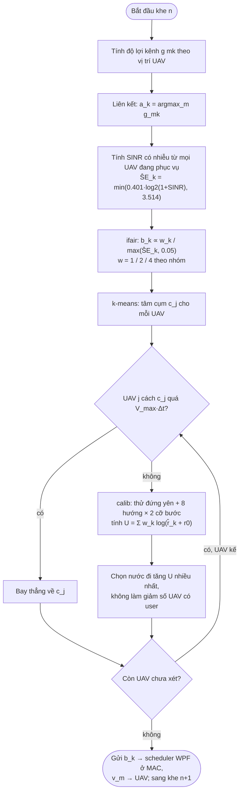

# Heuristic cải tiến `calib-ifair`

Tài liệu này gom riêng phần bài toán tối ưu, mã giả và lưu đồ của thuật toán đề xuất, để tiện đọc khi viết báo cáo và
làm slide.

`calib-ifair` là một **heuristic cải tiến**: nó tìm nhanh một nghiệm đủ tốt (vài mili giây mỗi khe) nhưng không đảm bảo
nghiệm tối ưu. Các thành phần dựa trên kỹ thuật đã có (công bằng tỷ lệ có trọng số, max-min có trọng số, đặt UAV theo
k-means, tìm kiếm cục bộ, scheduler PF có trọng số); điểm cải tiến là cách kết hợp (chia băng có tính nhiễu, tinh chỉnh
vị trí theo cùng mục tiêu có trọng số nhóm, áp ở tầng MAC) và việc kiểm chứng ở mức gói tin bằng NS-3 LTE. Khi trình
bày nên gọi là "heuristic cải tiến", không gọi là "thuật toán mới" hay "thuật toán tối ưu". Nội dung khớp với `BAO_CAO_DU_AN.md` (mục 4.10, 4.11, 5.5, 6.12) và với code trong `uavsim/algorithms.py`.

---

## 1. Bài toán

M UAV bay ở độ cao cố định, mỗi chiếc mang một trạm gốc LTE (eNB), phục vụ đường xuống cho K user mặt đất trong vùng
L × L. Thời gian chia thành các khe Δt. Mỗi user thuộc một trong ba nhóm:

| Nhóm c | Ví dụ | Trọng số w_c | Tốc độ mong muốn r_min,c | Tỷ lệ trong thí nghiệm |
|---|---|---|---|---|
| normal | Người dân | 1 | 0.5 Mbps | 60% |
| important | Điều phối, camera giám sát | 2 | 1 Mbps | 25% |
| critical | Đội cứu hộ, y tế | 4 | 2 Mbps | 15% |

Mỗi khe, thuật toán quyết định:

| Biến | Ý nghĩa |
|---|---|
| a_k[n] ∈ {1..M} | user k nối với UAV nào |
| b_k[n] ∈ [0, 1] | phần băng thông của UAV dành cho user k |
| p_k[n] | công suất phát cho user k (chia theo băng: p_k = b_k·P_max, không tối ưu riêng) |
| q_m[n] ∈ [0, L]² | vị trí UAV m (điều khiển qua vận tốc v_m) |

---

## 2. Bài toán tối ưu tổng quát (P)

$$
\textbf{(P)}\quad \max_{\{a_k[n]\},\,\{b_k[n]\},\,\{q_m[n]\}}\ \sum_{n=1}^{N}\sum_{k=1}^{K} w_{c(k)}\,\log\big(r_k[n] + r_0\big)
$$

Ràng buộc, với mọi UAV m và mọi khe n:

$$
\begin{aligned}
&\text{(C1)}\quad a_k[n] \in \{1,\dots,M\} && \text{mỗi user nối đúng một UAV}\\
&\text{(C2)}\quad \sum_{k:\,a_k[n]=m} b_k[n] \le 1,\quad b_k[n] \ge 0 && \text{tổng băng của UAV } m \le B\\
&\text{(C3)}\quad \sum_{k:\,a_k[n]=m} p_k[n] \le P_{\max},\quad p_k[n] = b_k[n]\,P_{\max} && \text{công suất}\\
&\text{(C4)}\quad \|q_m[n+1] - q_m[n]\| \le V_{\max}\,\Delta t && \text{tốc độ bay}\\
&\text{(C5)}\quad q_m[n] \in [0, L]^2 && \text{trong vùng}
\end{aligned}
$$

Tốc độ và SINR (kênh $g_{mk}(q_m)$ theo mô hình Al-Hourani, phụ thuộc vị trí UAV):

$$
r_k[n] = b_k[n]\,B\,\log_2\!\big(1 + \mathrm{SINR}_k[n]\big),\qquad
\mathrm{SINR}_k = \frac{\dfrac{p_k}{b_k B}\,g_{a_k k}(q_{a_k})}{\displaystyle\sum_{j \ne a_k} \frac{P_j}{B}\, g_{jk}(q_j) + N_0}
$$

Tham số: $r_0 = 1$ kbit/s (tránh log 0), $B = 10$ MHz, $P_{\max} = 1$ W, $V_{\max} = 20$ m/s, $L = 1000$ m, độ cao 100 m.

**Vì sao tổng log có trọng số.** Tối đa tổng tốc độ Σr dồn băng cho user kênh tốt, user ở rìa gần như không được phục
vụ. Tối đa tốc độ nhỏ nhất min r thì hy sinh nhiều tổng tốc độ. Tổng log nằm giữa: nó phạt rất nặng user có tốc độ gần
0 nhưng vẫn thưởng cho việc tăng tổng. Trọng số w đẩy nhóm critical lên trước mà không bỏ rơi nhóm khác.

**Ngưỡng r_min,c không phải ràng buộc cứng.** Khi kênh quá xấu hoặc quá tải thì không có nghiệm thỏa mọi ngưỡng, nên
ngưỡng chỉ dùng để chấm QoS từng nhóm (mục 6).

**Độ khó.** (P) không lồi, có biến nguyên (a_k), và nhiễu làm vị trí của mọi UAV ghép với nhau. Thuật toán chỉ giải xấp
xỉ, theo từng khe.

---

## 3. Bài toán mỗi khe mà thuật toán giải (Pₙ)

`calib-ifair` giải tham lam từng khe, thay tốc độ Shannon bằng tốc độ dự đoán $\hat r_k$ theo đường cong LTE đo được
từ NS-3 (có nhiễu, có trần):

$$
\textbf{(P}_n\textbf{)}\quad \max_{a,\,b,\,q[n+1]}\ U = \sum_{k=1}^{K} w_k \log\big(\hat r_k + r_0\big)
\quad \text{s.t. (C1)–(C5)}
$$

$$
\hat r_k = b_k\,B\,\widehat{SE}_k,\qquad
\widehat{SE}_k =
\begin{cases}
\min\big(0.401\,\log_2(1+\mathrm{SINR}_k),\ 3.514\big), & \mathrm{SINR}_k \ge 0.1\ (-10\text{ dB})\\
0, & \text{ngược lại}
\end{cases}
$$

(Pₙ) được tách làm ba khối, giải lần lượt:

### 3.1. Liên kết

$$a_k = \arg\max_{m} g_{mk}(q_m)$$

User nối với UAV có độ lợi kênh lớn nhất.

### 3.2. Chia băng `ifair` (vị trí cố định)

$$
b_k = \frac{w_k / \max(\widehat{SE}_k,\ 0.05)}{\displaystyle\sum_{k':\,a_{k'}=a_k} w_{k'} / \max(\widehat{SE}_{k'},\ 0.05)}
\quad\Longrightarrow\quad
\hat r_k = \frac{B\,w_k}{\displaystyle\sum_{k':\,a_{k'}=a_k} w_{k'}/\widehat{SE}_{k'}}
$$

- Công thức rút gọn bên phải chỉ đúng khi mọi user trong UAV có $\widehat{SE} \ge 0.05$. Khi đó, trong mỗi UAV
  $\hat r_k / w_k$ bằng nhau, tức max-min có trọng số: user critical có tốc độ dự đoán gấp 4 lần user normal cùng UAV,
  dù kênh của nó xấu hơn. User có $\widehat{SE} < 0.05$ nhận ít tốc độ hơn tỷ lệ này; user có $\widehat{SE} = 0$
  vẫn được cấp băng nhưng tốc độ bằng 0.
- $\widehat{SE}$ tính từ SINR **có nhiễu** (baseline `maxmin` dùng SNR không nhiễu, nên đánh giá sai user nào yếu).
- Sàn 0.05 bit/s/Hz để một user gần mất sóng không hút hết băng của UAV.
- Lưu ý: nghiệm đúng của bài toán con max Σ w·log(b·B·ŜE) với Σb ≤ 1 là $b_k = w_k/\sum w$ (băng tỷ lệ với trọng
  số, không phụ thuộc kênh). Thuật toán cố ý chọn cách chia khác để *tốc độ* tỷ lệ với trọng số, ưu tiên user yếu hơn.
  Hàm U chỉ dùng để chọn vị trí UAV ở khối sau.

### 3.3. Di chuyển `calib` (cách chia băng như 3.2)

$$
q_m[n+1] = q_m[n] + d_m^\star,\qquad
d_m^\star = \arg\max_{d \in \mathcal{D}} U\big(q_1,\dots,q_m + d,\dots,q_M\big)
$$

$$
\mathcal{D} = \{0\} \cup \Big\{ s\,\big(\cos\tfrac{i\pi}{4}, \sin\tfrac{i\pi}{4}\big) : i = 0..7,\ s \in \{V_{\max}\Delta t,\ \tfrac14 V_{\max}\Delta t\} \Big\}
$$

- 17 ứng viên mỗi UAV: đứng yên, 8 hướng × 2 cỡ bước.
- UAV còn cách tâm cụm k-means hơn một bước bay thì bay thẳng về tâm cụm (pha tiếp cận), chưa tìm cục bộ.
- Các UAV được xét lần lượt; UAV sau thấy vị trí mới của UAV trước (tối ưu theo từng tọa độ).
- Hàm U tính $\hat r_k = b_k B \widehat{SE}_k$ với $b_k$ chia đúng như 3.2 (cùng sàn 0.05), nên vị trí được chấm
  bằng chính tốc độ sẽ được cấp.
- Chỉ trong pha tìm kiếm cục bộ: loại nước đi làm giảm **số** UAV có user (pha tiếp cận không kiểm tra điều này, và
  một UAV vẫn có thể mất hết user nếu UAV khác cùng lúc có thêm user). Thiếu điều kiện này, tìm kiếm cục bộ hay "tắt" một UAV để giảm nhiễu tức
  thời và rơi vào nghiệm kém (ví dụ seed 1: sum rate 13 Mbps so với 43 Mbps).

### 3.4. Áp quyết định ở tầng MAC

$b_k$ được gửi xuống NS-3 làm trọng số cho scheduler **Weighted PF (WPF)**. Không có bước này, scheduler PF mặc định
của LTE tự chia lại tài nguyên và quyết định chia băng mất tác dụng (mục 6.3 của báo cáo).

---

## 4. Mã giả

```
Hằng số: α = 0.401, SE_max = 3.514, SE_floor = 0.05, r0 = 1e3 bit/s
         w = {normal: 1, important: 2, critical: 4}
         D = {(0,0)} ∪ {s·(cos iπ/4, sin iπ/4) : i = 0..7, s ∈ {V_max·Δt, V_max·Δt/4}}

Hàm SE_DỰ_ĐOÁN(q, U_xy):                                   // q: vị trí M UAV, U_xy: vị trí K user
    với mỗi UAV m, user k: g[m,k] ← độ lợi kênh Al-Hourani(q_m, U_xy_k)
    a_k ← argmax_m g[m,k]                                   // liên kết
    psd_m ← P_max / B nếu UAV m có user, ngược lại 0        // UAV không có user không phát
    với mỗi user k:
        S ← psd_{a_k} · g[a_k, k]
        I ← Σ_{j ≠ a_k} psd_j · g[j, k]                     // nhiễu đồng kênh
        SINR_k ← S / (I + N0)
        SE_k ← 0 nếu SINR_k < 0.1, ngược lại min(α·log2(1 + SINR_k), SE_max)
    trả về (a, SE)

Hàm TIỆN_ÍCH(q, U_xy, w):
    (a, SE) ← SE_DỰ_ĐOÁN(q, U_xy)
    với mỗi user k: x_k ← w_k / max(SE_k, SE_floor)        // đúng cách chia băng ifair
    với mỗi UAV m: tải_m ← Σ_{k: a_k = m} x_k
    với mỗi user k: r̂_k ← (x_k / tải_{a_k}) · B · SE_k
    U ← Σ_k w_k · ln(r̂_k + r0)
    N_hoạt_động ← số UAV có ít nhất một user
    trả về (U, N_hoạt_động)

Thủ tục CALIB_IFAIR_MỘT_KHE(q, U_xy, nhóm):
    w_k ← w[nhóm_k] với mọi k

    // Khối 1 + 2: liên kết và chia băng ifair
    (a, SE) ← SE_DỰ_ĐOÁN(q, U_xy)
    với mỗi user k: x_k ← w_k / max(SE_k, SE_floor)
    với mỗi UAV m:
        với mỗi user k có a_k = m: b_k ← x_k / Σ_{k': a_k' = m} x_k'
    p_k ← b_k · P_max

    // Khối 3: di chuyển calib
    c ← KMEANS(U_xy, khởi tạo = q)                          // tâm cụm, giữ thứ tự UAV
    q' ← q
    với mỗi UAV j = 1..M:                                   // lần lượt, UAV sau thấy q' mới
        nếu ‖c_j − q'_j‖ > V_max·Δt:
            q'_j ← q'_j + V_max·Δt · (c_j − q'_j) / ‖c_j − q'_j‖     // pha tiếp cận
            tiếp tục với UAV kế
        (U_tốt, N0_act) ← TIỆN_ÍCH(q', U_xy, w)
        d_tốt ← (0, 0)
        với mỗi d trong D \ {(0,0)}:
            q_thử ← q';  q_thử_j ← clip(q'_j + d, 0, L)
            (U_thử, N_thử) ← TIỆN_ÍCH(q_thử, U_xy, w)
            nếu N_thử ≥ N0_act và U_thử > U_tốt:              // không làm giảm số UAV có user
                U_tốt ← U_thử;  d_tốt ← d
        q'_j ← clip(q'_j + d_tốt, 0, L)
    v ← (q' − q) / Δt                                       // vận tốc, ‖v_j‖ ≤ V_max

    trả về (a, b, p, v)                                     // b → trọng số WPF ở tầng MAC

Vòng lặp mô phỏng:
    với n = 0 .. N−1:
        (a, b, p, v) ← CALIB_IFAIR_MỘT_KHE(q[n], U_xy[n], nhóm)
        mạng.bước(a, b, p, v)                               // tính SINR, tốc độ, hàng đợi, năng lượng
        q[n+1] ← q[n] + v·Δt
```

**Độ phức tạp mỗi khe:** k-means O(I·M·K), chia băng O(M·K), di chuyển O(M · 17 · M·K). Đo được 5.5 ms/khe với 3 UAV,
20 user và 13.6 ms/khe với 8 UAV, 60 user, nhỏ hơn nhiều so với khe 0.25 s.

---

## 5. Lưu đồ

Bản vẽ đẹp để chèn báo cáo: [`figures/calib_ifair.png`](figures/calib_ifair.png) (sửa bằng `figures/calib_ifair.drawio`).



---

## 6. Cách đánh giá

Mọi thuật toán được chấm bằng cùng chỉ số, đo ở mức gói tin bằng NS-3 LTE (eNB bay, UE, EPC, handover X2, UDP), trên
cùng seed:

$$
\text{Throughput} = \sum_k \mathrm{thr}_k,\qquad
\min_{k \in c} \mathrm{thr}_k \ \text{(theo nhóm)},\qquad
\mathrm{QoS}_c = \Pr_{k \in c,\,n}\big[\mathrm{thr}_k[n] \ge \min(r_{\min,c},\ 0.9\lambda)\big]
$$

$$
\text{Delay}_c = \frac{\text{tổng độ trễ gói của nhóm } c}{\text{số gói nhận của nhóm } c},\qquad
\text{PLR} = 1 - \frac{\text{gói nhận}}{\text{gói gửi}}
$$

λ là lưu lượng gửi tới mỗi user; ngưỡng dùng min(r_min, 0.9λ) vì user không thể nhận nhiều hơn phần được gửi.

### Các thuật toán so sánh

| Thuật toán | Mục tiêu nội tại | Tốc độ dùng để quyết định | Biết nhóm | Vai trò |
|---|---|---|---|---|
| `kmeans-equal` | gần max Σr (chia đều băng) | – | Không | Baseline hiệu quả |
| `kmeans-maxmin` | max min r trong UAV | Shannon, bỏ nhiễu | Không | Baseline công bằng |
| `kmeans-wmaxmin` | max min r/w trong UAV | Shannon, bỏ nhiễu | **Có** | Baseline biết nhóm |
| `calib-ifair-noclass` | Σ log r (w = 1) | LTE, có nhiễu | Không | Bỏ qua nhóm |
| `calib-ifair-shannon` | Σ w log r | Shannon, có nhiễu | Có | Cùng mục tiêu, như bài báo |
| **`calib-ifair`** | **Σ w log r** | **LTE, có nhiễu** | **Có** | **Đề xuất** |

### Kết quả chính (NS-3 LTE, 3 UAV, 20 user, 3 seed, WPF)

| Mbps/user | Chỉ số | kmeans-equal | kmeans-wmaxmin | **calib-ifair** |
|---|---|---|---|---|
| 2 | Critical đạt QoS | 69% | 87% | **97%** |
| 2 | Min throughput critical (Mbps) | 1.27 | 1.80 | **1.97** |
| 2 | Độ trễ critical (ms) | 1084 | 252 | **41** |
| 2 | Min throughput normal (Mbps) | 0.73 | 0.59 | **1.02** |
| 2 | Throughput tổng (Mbps) | 33.9 | 31.8 | 32.4 |
| 4 | Critical đạt QoS | 69% | 86% | **96%** |
| 4 | Min throughput critical (Mbps) | 1.64 | 2.79 | **3.25** |
| 4 | Min throughput normal (Mbps) | 0.68 | 0.49 | **0.95** |
| 4 | Throughput tổng (Mbps) | **49.9** | 44.3 | 44.1 |
| 4 | Mất gói (%) | **37.6** | 44.6 | 44.8 |

Bảng đầy đủ 6 thuật toán: `BAO_CAO_DU_AN.md` mục 6.12; số liệu `experiments/results/classes.csv`, hình
`experiments/results/classes.png`.

### Đọc kết quả

1. **Ưu tiên critical đứng vững trên NS-3:** tỷ lệ critical đạt QoS 96–97%, so với 59–69% ở các baseline không biết
   nhóm và 86–87% ở max-min có trọng số.
2. **Hơn cả baseline cùng biết nhóm:** so với `kmeans-wmaxmin`, min throughput critical cao hơn 9–16%, nhóm normal gần
   gấp đôi, throughput tổng như nhau. Lý do: tính nhiễu khi chia băng và tinh chỉnh vị trí UAV.
3. **Cái giá:** ở tải cao, throughput tổng thấp hơn baseline không biết nhóm khoảng 11% và mất gói cao hơn. Đây là
   đánh đổi có chủ đích, chỉnh được bằng trọng số w.
4. **Đường cong LTE không phải nguồn gốc cải thiện:** `calib-ifair-shannon` trùng `calib-ifair` trong 1–2%. Lợi ích đến
   từ việc tính nhiễu, tinh chỉnh vị trí, áp ở tầng MAC và trọng số nhóm.

---

## 7. Hạn chế

- Giải tham lam từng khe và tìm kiếm cục bộ: không đảm bảo tối ưu toàn cục.
- r_min theo nhóm chưa là ràng buộc cứng; khi quá tải vẫn có 3–4% (user, khe) critical dưới ngưỡng.
- Công suất và độ cao không được tối ưu.
- Với khe ngắn (0.25 s, chế độ dashboard), UAV có thể dao động quanh điểm tốt nhất ở tốc độ tối đa, tốn năng lượng bay.
- Mới đánh giá một cấu hình (3 UAV, 20 user, đô thị) với 3 seed; chưa có baseline tối ưu lồi có trọng số (BCD + SCA).
